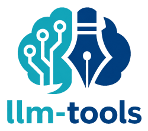
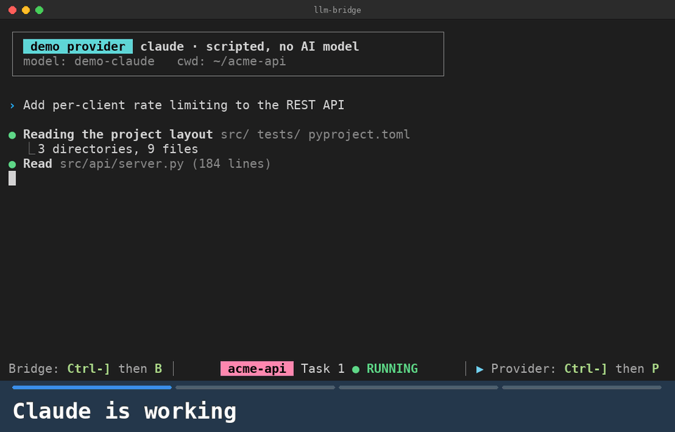
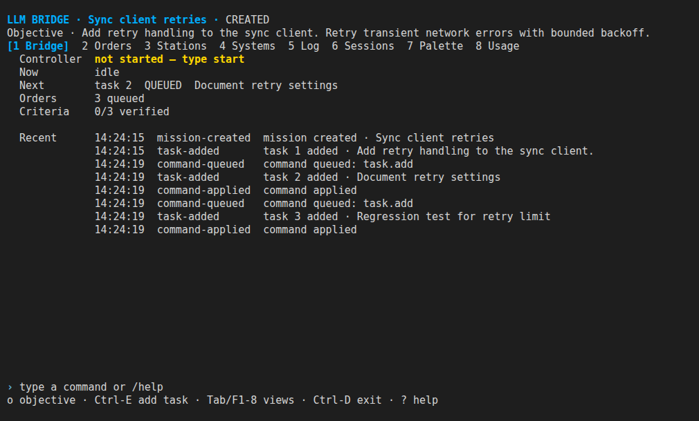
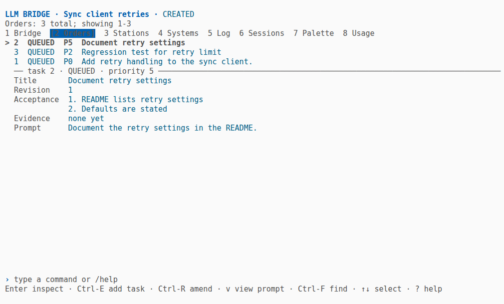
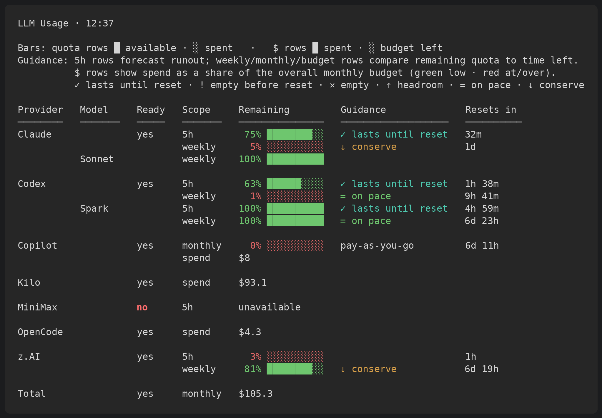

# llm-tools



[](https://github.com/chrisgleissner/llm-tools/actions/workflows/test.yml)
[](https://codecov.io/gh/chrisgleissner/llm-tools)
[](https://www.apache.org/licenses/LICENSE-2.0)
[](https://github.com/chrisgleissner/llm-tools/releases)

**Never lose an agent session to a rate limit again.**



You know the feeling:

- Codex hits its 5-hour wall at 3 pm, mid-refactor.
- Your weekly cap vanishes on Wednesday.
- The agent you left running at midnight stopped at 12:40.

`llm-tools` watches your limits, moves work to whichever provider still has capacity, and keeps long runs alive overnight and over SSH.

Project site: <https://chrisgleissner.github.io/llm-tools/>

## The toolbox

| Tool | What it does for you |
| --- | --- |
| [`llm-bridge`](#llm-bridge) | Supervises a task queue on Claude Code, Codex and Copilot. Kilo and OpenCode are available, with models pinned through routes. |
| [`llm-usage`](#llm-usage) | Shows what is left, and whether it will last. |
| [`llm-scheduler`](#llm-scheduler) | Starts a prompt the moment a provider has capacity. |
| [`ralph-robin`](#ralph-robin) | Hands work to the next provider when one runs dry. |
| [`llm-sleep-soak`](#ralph-robin) | Proves your machine wakes reliably. |

## Install

You need:

- Linux or macOS, and Python 3.11 or newer.
- For Bridge: `tmux`, and at least one provider CLI that is installed and signed in (Claude Code, Codex, Copilot, Kilo or OpenCode).

```bash
pipx install git+https://github.com/chrisgleissner/llm-tools.git
llm-bridge doctor
```

The install takes about 15 seconds. `doctor` reads local files only and starts no provider:

```text
tmux             available
Providers        claude: installed, logged in
                 codex: installed, logged in
Next             Ready. In your project folder run llm-bridge, press N, type the task, then choose Start.
                 Claude Code asks once to trust a new folder: choose "Yes, I trust this folder".
```

If tmux is missing, or no provider is signed in, the `Next` line says what to fix. No `pipx`, or another route? See [install paths](./docs/reference.md#install-paths). Check the installed version with `llm-bridge --version`.

## Your first Bridge mission

Run this in a folder you are happy for an agent to edit, for example a new empty git repository. With a signed-in provider it takes about a minute.

1. Run `llm-bridge` and press `N`. The home screen starts no provider.
2. Type the task, for example `Create a file named hello.txt containing the word hello, then stop.`
3. The form selects the first provider that is installed and signed in, shown as `[1] claude`. Press `Tab` five times to reach **Start and open provider**. Its hint reads `Starts claude now · uses provider capacity`. Press `Enter`. This is the step that uses paid capacity.
4. The provider opens in its own terminal inside Bridge. Claude Code may first ask whether you trust the folder. Choose **Yes, I trust this folder**. The first option is **No, exit**. If you pick it, Claude exits with status 1. Bridge does not start it again. It holds the task, and the status and the Needs you row say `Claude Code was not allowed to trust this folder · trust it and run /start again, or choose another provider with /rotation`. Run `/start` to start Claude again, and the prompt returns.
5. When the provider says it is done, exit it with `/exit`. Bridge then shows:

   ```text
   Provider exited (status 0) · Task 1 is waiting for your review. Ctrl-] then B, then /approve or /reject.
   ```

6. Press `Ctrl-]`, then `B`. Type `/approve`, press `Enter`, then press `y` to confirm. The controls show `✓ COMPLETED` and `mission completed · 1/1 tasks completed`.
7. Press `Ctrl-]`, then `d`, to leave the station. Bridge opens the mission controls in your own terminal; press `Ctrl-D` to leave them. The terminal prints `Detached from mission … the mission is completed`, and `hello.txt` is in your folder.

A task never completes on the provider's exit alone. It waits in `VERIFYING` until you approve it, or until a verifier you configured passes.

The form has no model setting, so the provider uses its own default. To try a particular Claude model, start Bridge as `ANTHROPIC_MODEL=<model> llm-bridge`.

The same flow from a script, with no terminal attached:

```bash
llm-bridge mission create --file task.md --name demo --native
llm-bridge start                       # the mission is inferred from the folder; on a terminal it opens the station
llm-bridge status                      # after the provider exits, "Needs you" shows the approve command
llm-bridge task verify --task 1 --approve
```

## The 60-second tour

```bash
llm-usage
```

`llm-usage` queries every installed provider at the same time. On an empty cache the table appears after about 3 seconds, with any provider still being read shown as `reading…`, and it redraws in place when they finish. With the sampler service running it is instant. A spinner on stderr shows progress. Example, trimmed:

```text
Provider   Ready   Scope    Remaining        Guidance              Resets in
Codex      yes     5h       90% █████████░   ✓ lasts until reset   4h 34m
                   weekly   34% ███░░░░░░░   ↓ conserve            5d 2h
Claude     no      5h        0% ░░░░░░░░░░   × empty               36m
                   weekly   91% █████████░   ↑ headroom            5d
```

Claude is empty for 36 minutes. Queue the prompt:

```bash
llm-scheduler --provider claude --prompt-file task.md
```

Or follow the capacity:

```bash
ralph-robin --prompt-file task.md
```

```text
[16:22:47] ◆ ralph-robin: ✓ selected codex (even-burn)
```

Or supervise a mission:

```bash
llm-bridge
```

## LLM Bridge

Your agents work. Bridge keeps the plan, the evidence and the controls. Close the laptop. The mission waits.

<p>


</p>

- **Missions outlive your session.** Tasks, evidence and history live in a local database.
- **Providers keep their own UI.** Native mode runs the real CLI in a private tmux station.
- **You approve, not the exit code.** Finished work waits in `VERIFYING` until you approve it, or a verifier you configured passes.
- **Capacity stays visible:** `claude · 5h 77% left, resets 4h 43m · weekly 56% left, resets 6d 5h`.
- **Many missions, many repos.** `Ctrl-]` then `m` jumps between them; on the CLI, use an ID prefix or just `cd` into the folder.

Day one is in [Your first Bridge mission](#your-first-bridge-mission).

In a station, `Ctrl-]` is the prefix:

| Keys | Action |
| --- | --- |
| `Ctrl-]` then `B` | Bridge controls |
| `Ctrl-]` then `P` | Back to the provider |
| `Ctrl-]` then `m` | Mission picker |
| `Ctrl-]` then `z` | Toggle zoom |
| `Ctrl-]` then `d` | Detach; the mission keeps running |
| `Ctrl-]` then `?` | Help |

The controls feel like Codex and Claude Code: eight tabs on `F1`–`F8` (Overview, Tasks, Providers, Activity, Sessions, Health, Actions, Usage), `Ctrl-K` for actions, and slash commands such as `/start`, `/approve`, `/reject 2 needs tests`, `/finish` and `/missions`.

[Go deeper →](./docs/llm-bridge/operations.md)

## llm-usage

Know before you start: one row per limit, plus a forecast.



- Reads Codex, Claude Code, Copilot, Kilo, MiniMax, OpenCode and Z.ai.
- Refreshes live.
- Offers JSON and a Claude Code statusline.

```bash
llm-usage --watch 60          # live dashboard
llm-usage --json              # scripts
llm-usage --service-install   # background sampler
```

[Go deeper →](./docs/llm-usage.md)

## llm-scheduler

Launch one prompt the moment a provider has capacity.

- Waits for the real reset time.
- Runs interactively or headless.
- Retries rate limits (60, 180, 600 seconds).
- Starts at a set time or after a wake.

```bash
llm-scheduler --provider codex --prompt-file task.md
llm-scheduler --provider codex --prompt-file task.md --at "23:05"
llm-scheduler --provider codex --prompt-file task.md --dry-run   # plan only
```

[Go deeper →](./docs/llm-scheduler.md)

## ralph-robin

A [Ralph loop](https://venturebeat.com/technology/how-ralph-wiggum-went-from-the-simpsons-to-the-biggest-name-in-ai-right-now/) that outlasts any one provider. Codex runs dry, Claude takes over, you keep shipping.

- Rotates providers, burning quotas evenly. The default rotation is `claude,codex,opencode`, or whatever `[ralph].providers` in your config says.
- With everything exhausted, suspends the machine and wakes it at the earliest reset.
- Holds an idle inhibitor, so your desktop cannot suspend it mid-task.
- Never suspends without a wake alarm.

```bash
ralph-robin --prompt-file task.md
ralph-robin --providers claude,codex --prompt-file task.md
llm-sleep-soak --cycles 20 --period 2m --json   # real suspend/wake test
```

Run `llm-sleep-soak` once before an overnight job.

[Go deeper →](./docs/ralph-robin.md)

## Works the way you do

- **Keyboard first, mouse welcome.** `?` opens help for the current view; the wheel scrolls and selects.
- **SSH friendly.** Missions belong to your user, not your login. Start at your desk, check in from your phone's terminal, detach, carry on. If the connection drops, the Bridge screen exits with status 129 instead of spinning; the mission keeps running.
- **Light and dark.** Auto-detected; force with `LLM_BRIDGE_THEME=light|dark`; preview with `llm-bridge theme`.
- **`NO_COLOR`** gives monochrome. States always carry a glyph and a word.
- **ASCII locales.** Plain ASCII under `LANG=C`.

## Privacy and safety

No telemetry and no network listener. Quota reads use your existing provider credentials. Bridge never marks work done without you, or a verifier you configured. Paid capacity is used only when you start work.

## More

- Docs: [Bridge](./docs/llm-bridge/operations.md) · [llm-usage](./docs/llm-usage.md) · [llm-scheduler](./docs/llm-scheduler.md) · [ralph-robin](./docs/ralph-robin.md) · [Configuration](./docs/configuration.md) · [Reference](./docs/reference.md)
- Needs Linux or macOS, Python 3.11+, your provider CLIs, and `tmux` for Bridge.
- Contributing: [small, focused PRs](./docs/reference.md#contributing).
- License: Apache 2.0.
