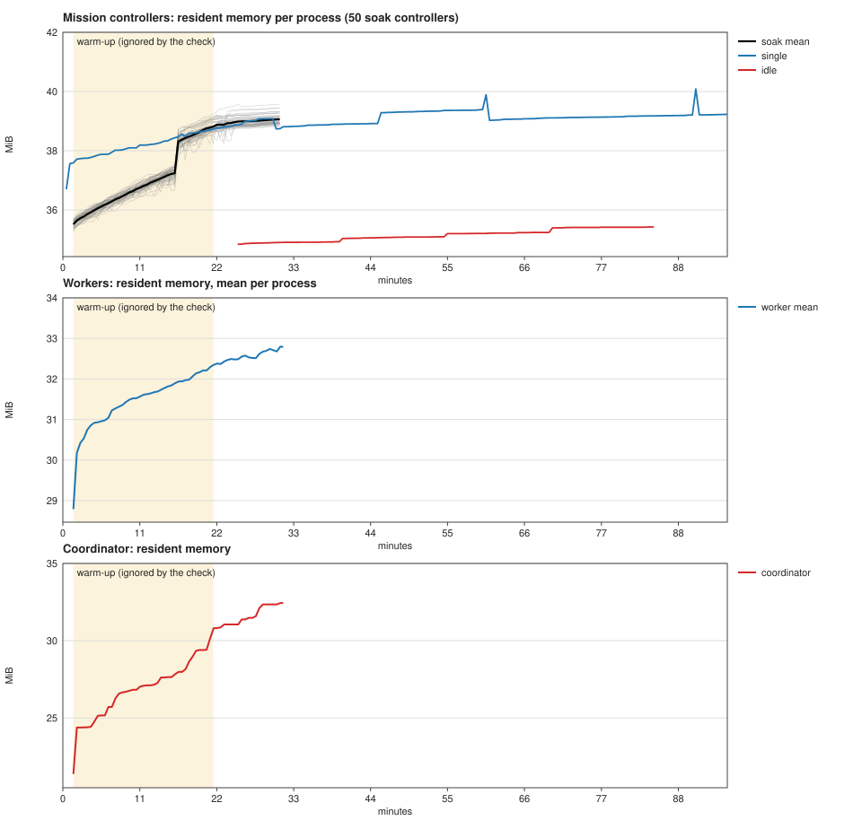
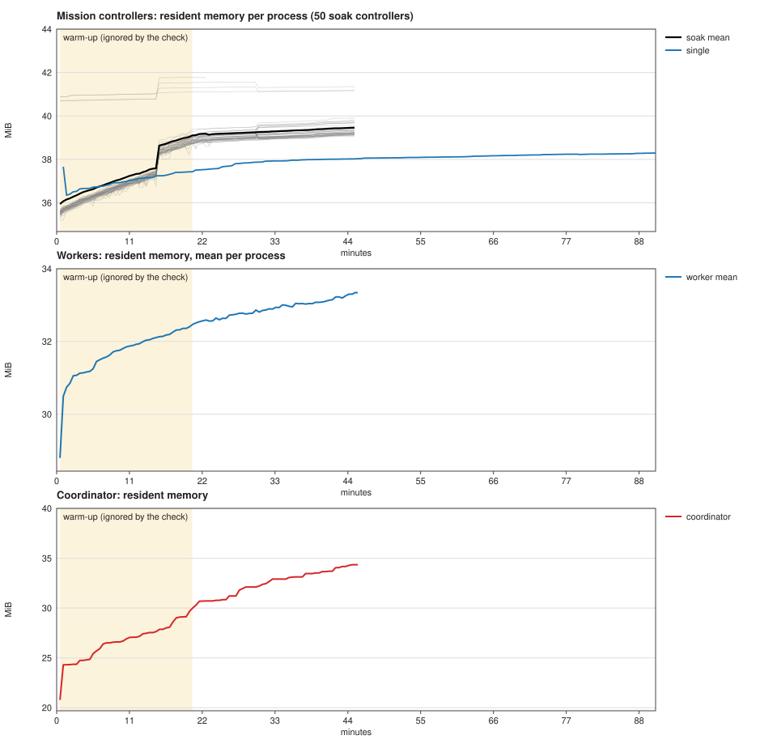

# Soak and fault-injection tests

Two harnesses check the distributed Bridge as a whole system, with real processes and fake providers:

- `scripts/bridge_soak.py` is the soak test (PRD-007): one coordinator, N workers and M missions run for a
  fixed time while commands are issued and resources are sampled.
- `scripts/bridge_chaos.py` is fault injection (PRD-008): one failure at a time, each with a declared
  expected outcome and a test.

Both use `scripts/dist_harness.py` (processes, command ledger, sampling, statistics),
`scripts/dist_ws_proxy.py` (a WebSocket frame proxy), `scripts/bridge_soak_provider.py` (the fake provider)
and `scripts/chaos_clock_shim.c` (a wall-clock shim). They use the standard library plus the `openssl`
and `cc` command line tools, which every Linux CI image has. They read `/proc`, so they run on Linux only.

Nothing real is touched. Every child process gets an environment built from scratch: a `HOME` inside the
run directory, its own `LLM_BRIDGE_STATE_DIR`, `XDG_RUNTIME_DIR`, config and cache, no inherited `LLM_*`,
`TMUX` or credential variables, provider capacity injected through `LLM_SCHEDULER_USAGE_JSON_FILE`, and
`LLM_SCHEDULER_NO_ACTUAL_SUSPEND=1` and `LLM_TOOLS_NO_INHIBIT=1` so that a rate-limit wait can never suspend
the machine. The coordinator and the proxies bind 127.0.0.1 only. Run directories are removed after a
passing run and kept after a failure (the path is printed).

## Running them

```bash
cargo build --release --manifest-path coordinator/Cargo.toml      # or --build, or --coordinator-bin PATH

# PRD-007: the scaled-down run in the PRD (30 minutes, 10 workers, 50 missions) is the default
python scripts/bridge_soak.py --report soak.json
python scripts/bridge_soak.py --duration 300 --workers 3 --missions 10 --sample-seconds 15     # pull request size
python scripts/bridge_soak.py --duration 86400                                                 # the full 24 hours

# PRD-008
python scripts/bridge_chaos.py --list                     # faults with their expected outcomes
python scripts/bridge_chaos.py                            # all faults, JSON report in chaos-report.json
python scripts/bridge_chaos.py --fault disk-full --fault ws-dropped-frames
```

The binary is `--coordinator-bin`, then `BRIDGE_COORDINATOR_BIN`, then
`coordinator/target/release/bridge-coordinator`, then the debug build. Both scripts print a human summary,
write a JSON report, and exit 1 when a check fails, 2 on a usage error and 3 when no binary is found.

## Soak

### What runs

- One coordinator and `--workers` worker processes (`llm-bridge worker run`), each enrolled with
  `--allow-control` and a state directory of its own.
- `--missions` headless missions spread over the workers. Each runs a controller and the fake provider with
  a verifier (`true`), and starts with `--backlog` queued tasks.
- The fake provider (`scripts/bridge_soak_provider.py`) picks one behaviour per run from a seeded stream:
  `output` (progress lines, exit 0), `question` (asks a yes/no question and waits; the scheduler aborts it
  as a blocked prompt), `ratelimit` (prints a 429 message, exit 1) and `crash` (dies with SIGKILL). The
  default weights are 80/5/10/5. `--provider-speed` divides its delays (default 0.1; a larger number is faster, and one `output` run takes 1.6 s divided by it plus about 5 s of scheduling, so about 21 s by default).
- Every `--limit-every` seconds each worker's injected capacity runs out for `--limit-seconds`, so the
  controllers also meet a capacity wait with a real reset time.
- Two command threads issue `--command-rate` commands per second in total through the coordinator:
  60% `task.add` with a unique request ID and a unique prompt (`marker:<id>`) as its checkable effect,
  10% a repeat POST of an earlier request ID (a client retry), and 30% reads (`mission.status`,
  `task.list`, `mission.list`) that wait for the worker's answer. A POST that fails is repeated under the
  same ID until the coordinator accepts it.
- A read thread requests the mission list, worker list and diagnostics once per second, and an operator
  thread restarts a mission whose controller ended while tasks were still queued.

### Pass criteria

Each is a line in the report. Any failure gives exit status 1.

| Check | Rule |
|---|---|
| Commands exactly once | After the load stops, every accepted command reaches `done` within `--settle-seconds`. Then the coordinator journal, the worker `commands` table and the worker `tasks` table are compared. Failures: an `applied` command whose effect is missing (silent loss); an effect present more than once; an effect present for a `rejected` or `failed` command (phantom); a command row count other than one; an accepted command missing from the journal; a command that never finished. `uncertain` outcomes are allowed and counted, and their effect may exist at most once. |
| Resource slopes | The coordinator, the workers and the controllers are sampled every `--sample-seconds` (default 60) from `/proc` and `diagnostics`. The first `--warmup-seconds` (default 1200, never more than two thirds of the run and never less than `--warmup-fraction` of it, default 25%) of each series is ignored: memory has not settled in the first 20 minutes (see Memory over time). A least-squares line is fitted through the rest. A metric fails when its slope is above the bound per hour **and** the fitted rise over the window is above the floor. The floor stops a few units of cache or allocator noise in a short run from being extrapolated to a failure. With too few samples the result is `inconclusive`, which fails; `bridge_soak.py` refuses a run that cannot collect four samples after warm-up. The controllers are judged one process at a time (see the table below). |
| Memory ceilings | The largest sample of any single controller or worker, and of the coordinator, stays under the absolute ceilings in the table below. A process that settles at a size it should never reach fails even when its slope is flat. The warm-up is included. |
| Database explained by rows | At every sample the coordinator database (main file plus WAL) is at most 8 MiB + 4096 bytes times the row count of `events`, `commands` and `audit`. The database slope floor also grows with the new rows, so the slope check fails only for growth that rows do not explain. |
| Events within retention | The stored event count never exceeds workers x `max_events_per_worker` (50 000). |
| p99 API latency | Per request class from the client's point of view, loopback. |
| Coordinator survived | The process is alive at the end and its log has no panic. |
| Workers online | Every worker is online at the end. |
| Missions made progress | At least one task completed fleet-wide. |

Bounds (defaults in `dist_harness.DEFAULT_BOUNDS`; each can be changed with `--bound-<metric>` in
units per hour, for example `--bound-coordinator-rss-kib 4096`):

| Metric | Bound per hour | Floor | Notes |
|---|---|---|---|
| `coordinator_rss_kib` | 8192 KiB | 4096 KiB + 256 bytes per new row | Resident set of `bridge-coordinator`. It grows with the stored events (81 to 96 bytes per row on the debug build used for the 2026-11-07 runs) until the retention cap, so the floor allows 256 bytes per new row (`COORDINATOR_RSS_BYTES_PER_ROW`). The same growth with no new rows fails. `benchmarks.md` measures 26 MiB after 1000 events and 30 MiB after 10 000. |
| `coordinator_fds` | 4 | 4 | Open descriptors. A bounded number of workers and API connections means none should accumulate. |
| `coordinator_threads` | 2 | 4 | Operating-system threads. This is the task metric: the number of async tasks inside the coordinator is not exposed on this branch (see Phase B). |
| `coordinator_db_bytes` | 32 MiB | 8 MiB + 4096 bytes per new row | `coordinator.sqlite3` plus its WAL. Until the event retention cap is reached the database grows with the stored events by design; the floor allows exactly that. At the cap the slope has to flatten. |
| `workers_rss_kib` | 3072 KiB per worker | 1024 KiB per worker | Sum over the `llm-bridge worker run` processes; bound and floor are multiplied by the worker count. Measured per worker after minute 20: 1.9 MiB per hour (45-minute run, 25-minute window) and 2.5 MiB per hour (30-minute run, 10-minute window), falling. |
| `workers_fds`, `workers_threads` | 1 per worker | 1 per worker | Same. |
| `controllers_rss_kib` | 1536 KiB per controller | 512 KiB per controller | **Per process, not a sum.** Each controller is fitted on its own from `--warmup-seconds` after its first sample, and the median over the controllers is compared with the bound (and the median rise with the floor). A sum jumps when a controller exits or is restarted, and a restarted controller starts a new warm-up. Measured median per-controller slope after warm-up: 0.88 MiB per hour (45-minute run, 25-minute window) and 1.12 MiB per hour (30-minute run, 10-minute window). |
| `controllers_fds` | 1 per controller | 1 per controller | Same. |

`--bound-<metric>` replaces the per-hour number (per process for the rows that say so). The floors are fixed.

Ceilings (`dist_harness.DEFAULT_CEILINGS`, not adjustable from the command line; they apply to the largest single process):

| Series | Ceiling | Measured peak | Why this number |
|---|---|---|---|
| `controllers_max_rss_kib` | 56 MiB | 40.9 MiB, and 42.8 MiB for four controllers that started 6 MiB high (see Memory over time) | 1.3 times the largest measured peak. A controller runs per mission, on a host that may have 512 MB; a controller that settles 13 MiB higher than any measured one is a regression. |
| `workers_max_rss_kib` | 56 MiB | 34.1 MiB | 1.6 times the measured peak. |
| `coordinator_rss_kib` | 96 MiB | 34.3 MiB at 180 000 rows | 22 MiB at start plus 96 bytes for each of the 500 000 rows at the retention cap is 70 MiB; the ceiling adds 37%. |

p99 budgets (`--p99-read-ms`, `--p99-submit-ms`, `--p99-roundtrip-ms`):

| Class | Requests | Budget |
|---|---|---|
| `read` | `GET` of missions, workers, diagnostics, one command | 250 ms |
| `submit` | `POST /api/v1/commands` without `wait_ms` | 500 ms |
| `roundtrip` | `POST /api/v1/commands` with `wait_ms`, answered after the worker's result | 10 000 ms |

`benchmarks.md` measures 0.3 ms p50 for reads and 0.5 ms p50 for submissions with one client, so the read
and submit budgets are about 500 times the quiet-host median. They are a tripwire for a stall or a lock,
not a performance target. The round-trip budget includes the worker's polling interval and the
controller's database writes.

### Sizes and where they run

| Where | Size | Why |
|---|---|---|
| Pull requests (`soak-chaos` job in `test.yml`) | 5 minutes, 3 workers, 10 missions, sample every 15 s | The PRD asks for 30 minutes in pull-request CI. That would make every pull request wait for a run that is longer than the rest of the suite, on a 2-4 vCPU runner shared with the Rust, web and cross-platform jobs. The same harness runs in 5 minutes with about 20 samples (15 after warm-up), which catches a stall, a leak that grows by megabytes per minute, a latency regression and any exactly-once violation. The 30-minute run is executed every night. |
| Nightly `soak-30min` (`soak-nightly.yml`) | 30 minutes, 10 workers, 50 missions, sample every 60 s | The PRD's scaled-down run. |
| Nightly `soak-long` | 4.5 hours (16 200 s), same size | A GitHub-hosted job is limited to 6 hours, so 24 hours cannot run there. |
| By hand (`workflow_dispatch`, input `duration` and `runner`) | 24 hours (`86400`) on a self-hosted runner | The full PRD run. |

The shorter runs measure the same rates as the 24-hour one. They cannot show effects that appear only
after a long time: the seven-day retention of finished commands, and the plateau of the database after the
event cap is reached (at the event rate measured on 2026-11-07, about 4400 events per minute for 50 missions, that takes about two hours with ten workers). The
4.5-hour run reaches the cap; the 24-hour run is the only one that exercises the seven-day pruning.

### Calibration

Measured on 2026-11-07 on an 8-core, 48 GiB Linux host with the release coordinator of this branch
(commit 42311db), before the bounds above were fixed. All runs used the fake provider mix 80/5/10/5
except the last.

| Run | Result |
|---|---|
| 2 min, 3 workers, 6 missions | All checks passed. 287 commands, all `applied`. Read p99 3.7 ms, submit p99 3.5 ms, round trip p99 82 ms. |
| 3 min, 10 workers, 50 missions | 434 commands all `applied`. Read p99 10.5 ms, submit p99 4.3 ms, round trip p99 84 ms. Coordinator RSS 16.0 to 16.6 MiB, 27 descriptors, constant thread count. 13 287 events and a 17.7 MB database. |
| 10 min, 10 workers, 50 missions | 1460 commands, all `applied`, none lost or duplicated. Read p99 7.4 ms, submit p99 4.3 ms, round trip p99 64 ms. Coordinator RSS 16.1 to 18.0 MiB (+2.5 MiB fitted), descriptors and threads constant, database 40 000 events and 1.2 KiB per row. 1426 tasks completed, 92 provider aborts (questions) recovered by themselves. **Controller memory grew**: the 50 controllers went from 1.80 to 1.88 GB. |
| 5 min, 1 worker, 6 missions, instant provider, 620 tasks | Controller memory grew from 221.3 to 233.7 MB in total, 2 MB per controller. This was first read as 20 KB per completed task; it is the start-up phase of six controllers, see Memory over time. Worker memory was flat (33 MB). |

Reading of the results:

- Coordinator memory, descriptors, threads, API latency and exactly-once delivery are well inside the
  bounds with a wide margin. The latency budgets are about 24 times the worst measured p99 for reads and
  100 times for submissions, which leaves room for a loaded shared runner.
- Memory of the mission controllers, workers and coordinator rises for about 20 minutes and then flattens.
  The earlier reading, 20 to 56 KB per completed task, was warm-up. One real leak was found and removed along
  the way (five immortal interned strings per provider run in the controller). The measurements, the fix and
  the gate are under Memory over time below.
- Worker memory rose about 9 MiB in ten minutes with 50 missions (about 0.9 MiB per worker, mostly early),
  which the per-worker floor accepts; the single-worker run was flat.
- The database stayed at about 1.2 KiB per row (rows are `events`, `commands` and `audit`), against the
  budget of 4 KiB per row plus 8 MiB.


### Memory over time

PRD-007 forbids unbounded growth, so the first soak finding (controller memory growing by 20 to 56 KB per
completed task) was investigated before any bound was set. This section records what was measured, what was
fixed and why the gate is what it is. Decision D16 in `DECISIONS.md` summarises it.

**Method.** `scripts/soak_sampler.py` writes one CSV row per process every 30 s (resident and anonymous
memory, threads, descriptors) for every controller and worker of a run, and `scripts/soak_plot.py` draws it
(`soak-and-chaos/memory-before.svg` and `memory-after.svg`, with the warm-up window shaded). The same runs were
made before and after the fix on an 8-core host, with the debug coordinator of this branch, the fake provider mix
80/0/10/10 at speed 0.1 and a 20 s capacity limit every 240 s:

- one headless mission with no coordinator, about one task per 18 s, 90 to 95 minutes
  (`scripts/controller_rss_repro.py`);
- the full-size soak, 10 workers and 50 missions, 30 minutes before the fix and 45 minutes after
  (`scripts/bridge_soak.py`);
- a controller run inside the test process, with `tracemalloc`, and in a second form with `mallinfo2`,
  SQLite's memory counters and `malloc_trim(0)`.

**Does it flatten?** Yes. Before the fix, the 50 controllers rose by about 120 KiB per minute for 15 minutes
(mean 35.5 to 37.3 MiB), took one 1.2 MiB step at minute 16 (all of them within the same 30 s sample) and then
moved by 50 KiB per minute or less (39.0 MiB at minute 30). The single controller went from 36.7 MiB to 38.5 MiB
in 17 minutes and then moved by 0.32 MiB per hour for 74 minutes (peak 40.1 MiB, 311 tasks). It also shows
spikes of about 0.9 MiB that last one sample and come every 15 minutes, which is the interval of the capacity
refresh worker's prune pass (`bridge_refresh.PRUNE_INTERVAL_SECONDS`; the timing matches, the cause was not
separately proven). Workers rose from 28.8 to 32.8 MiB with the rate falling, and the coordinator rose with its
row count (21.4 to 32.4 MiB for 3.6k to 125k rows, 96 bytes per row).

**The leak.** One thing did grow without bound. CPython 3.12 makes every string passed to `sys.intern`
immortal, and `pathlib` interns every path component it parses. Each provider run therefore left five new
strings in the controller for the rest of its life: the iteration directory `iter-NNN-provider` (parsed in
`ralph_robin`), the verifier context and log file names (`run_configured_verifier`), and the pids of the
provider and the verifier (`/proc/<pid>/stat`). They were found by recording every new interned string with its
call site while a controller ran 300 tasks (5.00 new strings per task) and by listing the call sites with
`tracemalloc` traceback grouping (the traced Python heap grew by 0.33 KiB per task, 8929 to 8982 KiB over 163
tasks). On Python 3.12.3, `sys.intern` of 20 000 unique strings leaves 2.4 MB allocated after the last
reference is dropped, plain strings leave nothing, and parsing 20 000 unique paths with `pathlib.Path` leaves
2.1 MB.

**The fix.** `common.RunPath` is `PosixPath` with the 3.12 POSIX parser minus the `sys.intern` call. It is used
for the iteration directory, the verifier directory and the paths derived from them (log pruning, diagnostic
sidecar, output tail). `/proc` files are read with `open()` on the string name (`fileio.read_proc_text`), and
`read_provider_diagnostic` opens its argument directly. On any other Python version, and if the pathlib
internals are not what the class expects (checked once at import), `RunPath` is the plain path class, because
other versions free interned strings. Behaviour and file layout are unchanged.

| | Before | After |
|---|---|---|
| New interned strings per task (300 tasks, instant provider) | 5.00 | 0.00 |
| Same with crashes, rate limits and capacity limits (100 tasks) | not measured | 0.00 |
| Traced Python heap, instant provider | +0.33 KiB per task (163 tasks) | +0.02 KiB per task (455 tasks, 8901 to 8911 KiB) |
| Traced Python heap, soak cadence, 62 runs in 20 minutes | not measured | +74 KiB, of which about 30 KB is the capacity forecast cache (`lru_cache`, 256 entries) filling to its cap |
| `test_controller_keeps_no_strings_per_provider_run` (24 runs through `run_controller`) | fails: 90 new strings after 18 runs | passes: at most 4 |

**What is left.** The RSS slope did not move visibly, and it could not be expected to: the interned strings are
about 0.3 KiB per run (about 50 KiB per hour at the soak's three runs per minute), far below the allocator noise
of a 40 MiB process. The single controller after the fix: 37.7 MiB at the start, 38.3 MiB at the end, 0.51 MiB
per hour after minute 20 over 70 minutes (0.32 before; the difference is within the run-to-run spread). A
fast-mode comparison on 4000 tasks gave 0.355 KiB per task after and 0.384 before. The remaining growth is not
live memory. In a controller run in the test process for 35 minutes (300 s to 2400 s) the resident anonymous
memory rose from 20.9 to 23.6 MiB while the glibc heap in use rose from 6.12 to 6.26 MiB. The rest was free
memory the allocator had not returned, and `malloc_trim(0)` brought the process to 20.2 MiB, below the first
reading. In a 20-minute run with SQLite's own counters, `sqlite3_memory_used` rose from 1.63 to 2.38 MiB (page
cache filling toward `cache_size`, 2 MiB per connection by default), and `malloc_trim` gave back 1.5 of the
2.1 MiB. The controller's residual growth is therefore heap fragmentation and a bounded SQLite cache, not
accumulation. A periodic `malloc_trim` in the controller would remove most of it. It is not done because it is
glibc-specific and the measured amount is small.

Four of the 50 controllers in the after run started 6 MiB higher than the others (41.8 MiB at their first
sample) and stayed flat. They were the first four to start in a snapshot directory that had no byte-code cache
yet, so they compiled the modules in memory. The ceiling covers them (42.8 MiB peak).

**The gate.** Three changes.

1. *Warm-up in seconds, taken from the plot.* Memory settles about 20 minutes after a process starts. In the
   30-minute run before the fix, the per-controller median slope after minute 10, 15, 20 and 25 was 7.2, 2.9,
   1.17 and 0.89 MiB per hour. The check now ignores `--warmup-seconds` (default 1200) from the start of each
   series, and at most two thirds of the run. A fraction of the run cannot do this: 25% of 30 minutes is 7.5
   minutes, which is the steepest part of the curve, and 25% of the 5-minute pull request run is 75 s.
2. *Controllers per process, with a tight bound.* A restarted controller, or one that exits, makes the sum over
   the fleet jump. Each controller is now fitted on its own after its own warm-up, and the median over the
   controllers decides. The bound is 1536 KiB per hour per controller above 512 KiB of rise. Measured after the
   fix and after minute 20: 0.88 MiB per hour in the 45-minute run (25-minute window), 1.12 in the 30-minute run
   (10-minute window), 0.51 for the single controller (70 minutes). Before the fix: 1.17 in the 30-minute run
   and 0.32 for the single controller. The bound is 1.3 times the largest of these and one fifth of the 7.2 MiB
   per hour that the first reading would have given. The 30-minute run keeps a 10-minute window and passes. The
   5-minute pull request run keeps 100 s and relies on the floor and the ceilings.
3. *Absolute ceilings* (table above), per process, warm-up included. The pull request configuration (3 workers,
   10 missions, 5 minutes) passes the new gate: controller median 7.7 MiB per hour on the 100 s window but a
   rise of 0.19 MiB per process (floor 0.5), controller peak 36.4 MiB, worker peak 31.9 MiB, coordinator peak
   25.5 MiB.

Workers and the coordinator had the same weakness, warm-up inside the fit. A 30-minute run before this change
failed `workers_rss_kib` (3.7 MiB per hour per worker) and `coordinator_rss_kib` (18 MiB per hour) on the
25%-warm-up fit. With the 1200 s warm-up the worker slope is 1.9 to 2.5 MiB per hour per worker and falling
(bound 3 MiB; the floor of 1 MiB per worker is what protects a short window), and the coordinator's growth is
explained by its row count (256 bytes per row allowed, 81 to 96 measured). The coordinator figures come from
the debug build; the release build is smaller.

**Limits of this evidence.** The longest run is 95 minutes. The plateau is shown for 75 minutes after warm-up,
not for days. The 4.5-hour nightly run and the 24-hour run by hand are the evidence for a longer plateau, and
the ceilings are what fail them if the plateau does not hold. The fake provider finishes a run every 18 to 21
s, which is far faster than a real provider, so per-run costs are over-represented compared with production.
The 50-controller runs were on one host with Python 3.12.3.

Reproduce:

```
python scripts/soak_sampler.py rss.csv 30 /tmp/lbw- &           # per-process memory of a soak, until stopped
python scripts/bridge_soak.py --duration 2700 --sample-seconds 30 --report soak.json
python scripts/soak_plot.py --csv rss.csv --report soak.json --warmup-seconds 1200 --out memory.svg
python scripts/controller_rss_repro.py . 600 5400               # one controller, no coordinator
```





## Fault injection

Each fault starts its own coordinator and two workers on 127.0.0.1, injects one failure, and checks the
outcome below. All of them require, as PRD-008 does:

- no silent loss and no duplicate: an acknowledged command or event is never missing afterwards, and nothing
  is applied twice (the same ledger check as the soak, plus an exact comparison of worker and coordinator
  event ids);
- an uncertain outcome is reported as uncertain: a command whose result was lost stays `pending`, `sent` or
  `acked`, or ends as `uncertain`; it is never `done`/`applied` without its effect;
- recovery without a person: the system converges when the fault ends, with no worker restart and no manual
  step, except where a documented operator procedure is part of the expected outcome.

| Fault | How it is injected | Expected outcome | Test |
|---|---|---|---|
| `coordinator-restart` | SIGTERM and a new `serve` on the same data directory and port while about 30 commands are unfinished. A delayed link (120 ms plus jitter) keeps commands in flight. | Nothing lost or applied twice. Submissions refused during the outage are repeated under the same request ID and accepted afterwards. Both workers reconnect and the journal redelivers unfinished commands. Worker events replicate exactly. | `test_fault_meets_its_declared_outcome[coordinator-restart]` |
| `coordinator-kill9` | Same with SIGKILL. | As above. A command whose result was never recorded is redelivered; the worker answers from its stored outcome, so the effect exists once. An outcome that cannot be confirmed is `uncertain`. | `[coordinator-kill9]` |
| `worker-partition` | A byte-level TCP proxy (`tests/fault_proxy.py`) between one worker and the coordinator refuses new connections and resets existing ones. 20 commands are submitted and 600 events are produced while it is cut. | The coordinator marks the worker offline and its missions stale within 30 s, keeps answering, and leaves the commands `pending` or `sent`. After the link returns the worker reconnects by itself, the commands run once and the offline events replicate exactly. The other worker is unaffected. | `[worker-partition]` |
| `disk-full` | The coordinator runs with `SIGXFSZ` ignored; the harness lowers its `RLIMIT_FSIZE` to 64 KiB at run time with `prlimit`, so every write past that offset fails like a full volume, and lifts the limit later. | The process survives and keeps answering `/healthz`. Writes that cannot be stored are refused with HTTP 500 (or fail at the transport), and an answer of 2xx means the command is durable. When space returns, with no restart, refused commands are repeated under their ID and run once, workers are online and events replicate exactly. | `[disk-full]` |
| `clock-jump` | The coordinator runs with `LD_PRELOAD=chaos_clock_shim.so`; the wall clock is moved forward one hour, back two hours, then to real time while traffic continues. A reconnect after each step shows the shifted `last_seen`. | The coordinator stays up and keeps its worker connections (liveness uses monotonic time). Nothing lost or applied twice, event order by id intact, and the stamps the coordinator writes follow its shifted clock. | `[clock-jump]` |
| `ws-slow-frames` | `scripts/dist_ws_proxy.py` terminates TLS on both sides and holds every data frame for 250 ms in each direction. | Commands finish with a round trip of at least the injected delay, nothing lost or duplicated, events replicate exactly, and the worker does not reconnect. | `[ws-slow-frames]` |
| `ws-dropped-frames` | The same proxy swallows one `command` frame (coordinator to worker), one `command.result` frame (worker to coordinator) and one `events` batch. | A lost command or result leaves the command unfinished (`sent` or `acked`), never `done`, and the effect is absent (lost command) or present once (lost result). After the connection is renewed the command finishes and has its effect exactly once. A lost event batch is detected by the next batch (`events.nack`) and resent without a reconnect. | `[ws-dropped-frames]` |
| `db-corrupt-page` | The coordinator is stopped after a backup, the b-tree header of every page that holds one command is overwritten (the file then fails `PRAGMA integrity_check`), and the coordinator is started again. | The coordinator never serves a row from a corrupt page as intact: it refuses to start with a non-zero exit, or it answers the affected request with an error. Restoring the backup (the procedure in `install.md`) brings it back, the workers reconnect, and no command or event is lost. | `[db-corrupt-page]` |

The tests are in `tests/test_distributed_chaos.py`: one `test_fault_meets_its_declared_outcome` case per
fault (real binary, real worker processes, 5 to 45 s each), plus fast tests for the registry, this
document, the report and the clock shim. The statistics, the exactly-once check, the fake provider and the
proxy have fast tests in `tests/test_distributed_soak_harness.py`, and that file also runs a 45-second
soak with two workers and four missions.

### How faults are injected

- Network faults. `tests/fault_proxy.py` forwards TLS bytes untouched, so it can cut, stall, delay and
  throttle a link. It cannot lose one message, because removing bytes from a TLS stream breaks the stream.
  `scripts/dist_ws_proxy.py` therefore ends TLS on both sides: the worker trusts the proxy's own
  throw-away certificate (made with `openssl`, valid for 127.0.0.1 only), and the proxy verifies the
  coordinator's CA as a normal worker would. It parses the WebSocket frames of the worker protocol, so it
  can hold or drop a frame by direction and message `type`. No root, namespace or `iptables` is used.
- Disk full. A loopback device or a small file system needs root. The harness instead limits the file
  size of the running coordinator with `RLIMIT_FSIZE` (`resource.prlimit`, allowed for a process of the
  same user). Linux checks the limit against the write offset, so lowering it below the current database
  size makes every write beyond that offset fail with `EFBIG` at once, and raising it restores writes. The
  process starts with `SIGXFSZ` ignored, otherwise the kernel would kill it instead of failing the write.
  The harness injects `EFBIG`, not `ENOSPC`: it covers how the coordinator handles failing writes, not the
  kernel's space accounting.
- Clock jumps. The coordinator reads wall time through `SystemTime::now` and has no override. The
  harness compiles `scripts/chaos_clock_shim.c` and preloads it. The shim adds the number of seconds in a
  file to `CLOCK_REALTIME`, `gettimeofday` and `time`, reading the file again every 20 ms, and leaves
  monotonic clocks alone, as a stepped wall clock does. It works for the dynamically linked glibc build (the
  CI and developer build), not for the static musl container image. If no C compiler exists, the fault is
  reported as skipped with that reason, and a skip fails the run unless `--allow-skips` is given. The
  fault checks that the shim takes effect (the worker's `last_seen` moves by the offset) before it trusts
  the result.
- Corrupt page. The database is backed up with `bridge-coordinator backup`, the coordinator is stopped
  (which checkpoints the WAL into the main file), and the first eight bytes of each page that stores the
  command's text are replaced with `0xFF`. The harness first checks that SQLite's `integrity_check` reports
  the damage.

### Behaviour observed on this branch

These are results of the first runs, recorded because they decide what the expected outcomes can say.

- `db-corrupt-page`: the coordinator has no integrity check at start. It starts, answers `/healthz` with
  `200`, and returns `500` for the request that reads a damaged page. A damaged page therefore shows up as
  errors on some requests, not as a refusal to start. The fault accepts either behaviour and fails only if a
  damaged row is served as intact. A start-up `PRAGMA quick_check` (or an equivalent failing health check)
  would make the first case the rule.
- `ws-dropped-frames`: the journal redelivers a command only after a reconnect (`protocol.md`). When a
  `command` frame is lost on a live connection the command stays `sent` until the connection is renewed,
  and a lost `command.result` leaves it `acked`. The state is honest (never `done`), but nothing renews the
  connection while pings keep arriving, so such a command waits for the next reconnect. The fault renews the
  connection itself after six seconds to show the recovery.
- `disk-full`: with every write failing, all twelve submissions were answered with HTTP 500 and none was
  accepted, the process survived, and the same request IDs were accepted and applied once after the limit
  was lifted.

### Phase B

These need features that are not on this branch. Each is marked `TODO(phase B)` in the code and printed in
the reports.

- `coordinator-task-count`: `TODO(phase B)`: sample the coordinator's own task count. Until then the thread
  count of the process is the task metric (`coordinator_threads`). Expected: a `tasks` integer in
  `GET /api/v1/diagnostics`; add it to `Sampler.take` and `DEFAULT_BOUNDS`.
- `worker-command-backlog`: `TODO(phase B)`: sample per-worker unfinished command counts from
  `GET /api/v1/workers` (expected field `queue_depth`) so a growing backlog is a metric, not only the final
  `unfinished` check.
- `clock-jump-native`: `TODO(phase B)`: run `clock-jump` without the `LD_PRELOAD` shim once the coordinator
  reads its wall clock through a test override (expected: environment variable
  `BRIDGE_COORDINATOR_CLOCK_OFFSET_SECS`, read on every call), so the musl container build is covered too.
- `stale-journal-after-restore`: `TODO(phase B)`: a restored backup lacks commands issued after it was
  taken. Assert that the worker's stored outcomes are reconciled into the journal (expected endpoint:
  `GET /api/v1/commands?worker=NAME&state=unfinished`) instead of staying unknown.
