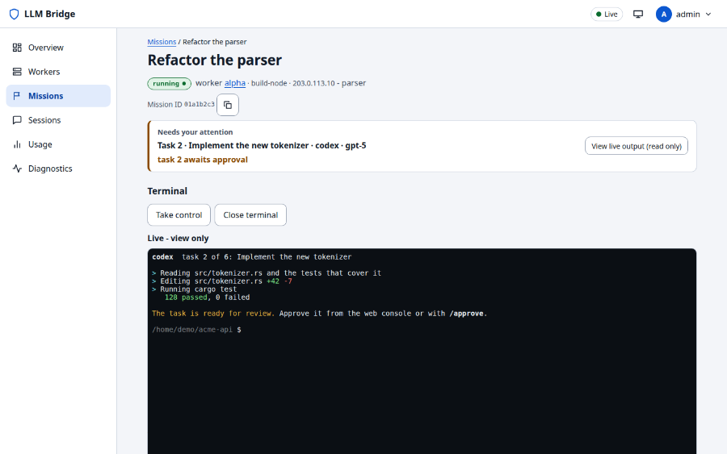
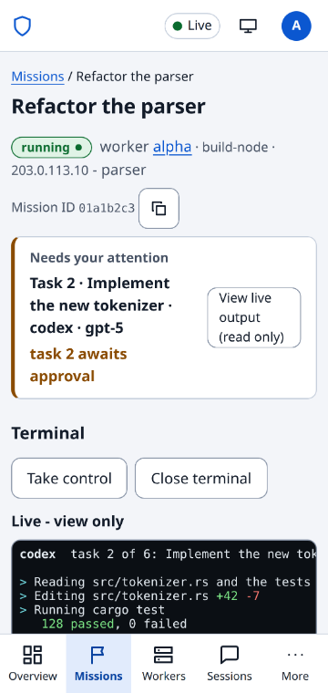

# Web console design specification (PRD-037)

Status: design, for implementation by the packages in section 11. Date: 2026-11-07. Branch: `feat/web-redesign`.
Inputs: the operator request, `ux-overseer-critique.md` (14 faults), `ux-research-2026-11.md` (the brief), its addendum (calm design, disclosure, fold, responsive), the task file with UXR-001..UXR-042, `ux-review-web.md` (WUX-001..033) and `ux-audit.md`.

## 1. Summary

The console becomes an attention queue plus a live-session workspace. Five decisions carry the redesign.

1. **One state model, one pill.** `deriveState()` (new `web/src/state.ts`) turns mission, task, worker and capacity facts into exactly one of ten states plus three entity states (Online, Ready, Unavailable). Every entity renders one `.pill` (icon, label, no second badge). The word "stale" disappears. Only the three alert states (Needs approval, Needs input, Failed) use saturated colour; every other state is neutral with a coloured icon. This is the calm-design rule from the addendum, and it is what makes a healthy running mission look quiet.
2. **Mission detail is a workspace.** A header with the state pill and state-dependent actions (Pause and Stop always visible), the live session pane in the first viewport (read-only by default, explicit Take control), a sticky composer under it, and a side panel with Tasks and Activity. At 1440x900 the session pane is about 75% of the viewport height, about 676 px (brief: at least 60%). Today the terminal starts at y=492, and Pause mission is at y=1069, the first task at y=1784 and the page is 3189 px tall. On Pixel 4 the terminal starts at y=580 behind a 64 px tab bar, so about 100 px of it is visible and the page is 4357 px tall.
3. **Inbox first.** `/` becomes "Inbox": a "Needs you" queue with inline Approve, Reject, Answer and Open, then quiet "Running" rows with provider state and time in state. Capacity chips sit in the header. Stat tiles, "Missions by status" and the global activity list are removed.
4. **One fluid design from 2560x1440 to 320x568.** Container queries on components, three layout breakpoints in rem, `clamp()` gutters and headings, `svh` for the session pane, a virtual-keyboard-aware composer, logical CSS properties, targets of 24 px (fine pointer) and 44 px (coarse pointer). Phones get designed list rows and a segmented Session / Tasks / Activity view, never label/value cards.
5. **Noise is classified at the source.** Events have three classes (milestone, detail, plumbing). Plumbing (heartbeats, capacity refreshes, bookkeeping) is counted, hidden by default, never toasted and never counted in totals. Raw JSON is a per-row disclosure that keeps the existing field allowlist. Toasts follow the interrupt ladder in section 6.4.

What does not change: vanilla TypeScript with esbuild, no framework; xterm.js in a lazy chunk; the API, the worker protocol and the `terminal:write` permission. Every backend capability the design uses exists today (section 9). Two things the brief asks for have no backend support and are cut or deferred with reasons in section 10: free-text chat to the provider outside the live terminal (`mission.steer` takes typed steering kinds only), and a last terminal output line for every running mission without opening a PTY.

The bundle budget (D17) is at its cap. The plan fits by moving `login`, `reset`, `account`, `workers`, `sessions`, `usage` and `diagnostics` into lazily loaded route chunks (about 28 KB raw of the 72.5 KB application chunk, measured per module with the esbuild metafile), by deleting the table-to-card CSS, tiles, status key/value table and per-column sort code, and by adding a separate cap for route chunks. Section 11 (WP-0) makes the measurement a gate and requires decision D18 before any cap changes.

## 2. State of the current console (measured, 2026-11-07)

Method: the built `web/dist` served by a real coordinator (`127.0.0.1`, throwaway data dir) with the deterministic API of `web/e2e/mock.ts`. Screenshots at 1440x900 and Pixel 4, light and dark, are in `/home/chris/llm-tools-infra/redesign-shots/before/` (101 files; not in the repository). Two reduced references are committed under `docs/distributed/web-design-spec/`. Scripts are in `/home/chris/llm-tools-infra/redesign-tools/`.

| Measure | 1440x900 | Pixel 4 (353x745) |
|---|---|---|
| Mission page: terminal top / height | y=492 / 540 px | y=580 / 447 px, tab bar covers y>=681 |
| Mission page: Pause/Continue/Cancel buttons | y=1069 | y=1085 |
| Mission page: tasks start / first task row | y=1784 / 50 px rows | y=2011 / 178 px per task card |
| Mission page: activity start, page height | y=2407, 3189 px | y=3454, 4357 px |
| Missions list: first row height | 134 px (id chip, copy button, current work) | 299 px per mission card |
| Focusable elements on mission page | 63 | 63 |

 

Causes found in code, not only in screenshots:

- **"stale" is on every mission.** The coordinator computes `stale = !online || event_cursor > mission_cursor` (`coordinator/src/http.rs`, mission list). Each heartbeat event advances the worker's event cursor but not the mission snapshot cursor, so a healthy running mission is "stale" most of the time. The UI shows that flag as a second badge (`views/mission.ts`, `views/missions.ts`) and `isStale()` also treats a disconnected stream as stale. The redesign ignores the replication flag for state and derives Offline from worker liveness only. A backend fix is optional and listed in section 14.
- **Heartbeat toast.** `views/mission.ts` calls `announce("New event: ...")` for the last event of every stream batch without checking `isPlumbing`.
- **Terminal below the fold** is a consequence of the page order (current work, terminal, actions, status table, tasks, events) and of the fixed `min(60vh, 36rem)` host height.
- **Attention state is not in the mission list.** `needs_you` in the list carries provider questions only. Approvals and failures need `mission.status` per mission, which `overview.ts` fans out for at most 12 active missions, three at a time. The Inbox keeps this fan-out (section 9).
- **Resizing the shared PTY.** In view mode the worker never resizes the tmux window (read-only control client, resize frames ignored). In write mode `terminal.ts` sends `{t:"r"}` from the browser's fitted size, which resizes the shared window for every other client. On a phone this shrinks the native station. UXR-041 forbids it (section 8.2).

## 3. Design rules (binding)

These come from the operator's calm, disclosure and above-the-fold principles and the addendum. Tests in section 12 check them.

1. **Calm by default.** A healthy running mission is a quiet row: neutral surface, muted text, a static ring icon, "Running 12m" at minute granularity. Saturated colour (tinted pill background and a 3 px leading bar) appears only on rank 1 and 2 states. No motion loops in lists. At most one running CSS animation per document, only on the focused mission (header ring, section 6.5). Nothing animates under `prefers-reduced-motion: reduce`. Terminal output is the one essential continuous update and has Follow / Paused.
2. **Interrupt ladder** (section 6.4): row order and counts, then an inline row, then a toast, then an opt-in browser notification. An interrupt is allowed only when the operator can act on it now.
3. **Progressive disclosure with two levels.** Level 0 is always visible, level 1 is one labelled interaction away, level 2 is raw or advanced and opens as a disclosure, dialog or route. A control needed in the current state (Approve, Reject, Pause, Stop, Retry on a failed item, Take control, the composer) is level 0 in that state and never sits in an overflow menu.
4. **Most important first.** Priority order on every page: state needing action, the action, identity (title), progress, context (worker, provider, time), history. Each page has a one-line answer under its title that says what is happening, whether it needs the operator, and what to do next (`data-q` hooks, section 12).
5. **Fold budget.** The addendum section 3.1 table is adopted unchanged as the minimum level-0 content per page and viewport (it is the oracle of test T29). Level-0 elements carry `data-l0`. The next section's heading peeks at the fold edge so there is no false floor.
6. **Truncate once** (section 6.3).
7. **One fluid design.** Components respond to their container, not to device names (section 3.6).
8. **Last-known state, with its age.** When the stream drops, the page keeps its data, shows "as of 14:02 (3m ago)" and disables mutations. It never blanks.

## 4. Design tokens

All styles come from tokens. `web/src/css/tokens.css` is the only file allowed to contain colour literals (test T02), apart from the xterm palette in `terminal-theme.ts`.

### 4.1 Type scale

Fixed `rem` UI text; only the page title is fluid. Base size is 14 px for dense lists, forms use 16 px (avoids iOS zoom on focus and is the existing mobile test floor).

| Token | Size | Line height | Use |
|---|---|---|---|
| `--fs-xs` | 12 px (0.75rem) | 16 px | pill label, timestamps, counts, meta, bottom bar labels |
| `--fs-sm` | 13 px | 18 px | secondary line, table-like detail, helper text |
| `--fs-md` | 14 px | 20 px | body, row title, buttons |
| `--fs-lg` | 16 px | 24 px | inputs, dialog title, empty-state title |
| `--fs-xl` | 20 px | 28 px | section title (h2 at page level) |
| `--fs-title` | `clamp(1.25rem, 1.1rem + 0.8vw, 1.75rem)` | 1.25 | page title (h1) |
| `--fs-display` | 28 px | 36 px | sign-in and first-run title only |

Weights 400, 500 (row titles, buttons), 600 (headings, pill label). `font-variant-numeric: tabular-nums` on counts, times, percentages, ordinals (class `.num`). `--font` and `--mono` stay as they are. The text never uses `vw` (200% zoom failure, Roselli).

### 4.2 Spacing, sizing, radii, elevation

| Group | Tokens |
|---|---|
| Spacing (4 px scale, unchanged values) | `--sp-1` 4, `--sp-2` 8, `--sp-3` 12, `--sp-4` 16, `--sp-5` 24, `--sp-6` 32, `--sp-7` 48 |
| Fluid spacing | `--gutter: clamp(0.75rem, 0.4rem + 1.6vw, 2rem)` (12 px at 320, 32 px at 1440); `--space-section: clamp(1rem, 0.6rem + 1.5vw, 2rem)` |
| Target | `--target: 24px`; `@media (pointer: coarse) { --target: 44px }` |
| Control height | `--control-h` 32 px (28 px for `.sm`); under `(pointer: coarse)` both are 44 px |
| Row height | `--row-h: 3rem` (48 px); `data-density="compact"` 2.5rem (40 px); coarse pointer 3.5rem (56 px), two-line rows 64 to 72 px |
| Chrome | `--head-h` 56 px from 48rem up, 48 px below; `--tab-h` 56 px plus `env(safe-area-inset-bottom)`; `--rail-w` 56 px (icon rail) or 208 px (labelled rail) |
| Radii | `--r-1` 6 px (kbd, code, small tags), `--r-2` 8 px (controls, rows), `--r-3` 12 px (panels, dialogs, sheets), `--r-pill` 999 px |
| Elevation | `--e0` none (flat panel with border; lists and cards use this), `--e1` `0 4px 16px rgb(16 24 40 / 12%)` (menus, popovers), `--e2` `0 16px 48px rgb(16 24 40 / 24%)` (dialogs, sheets). Dark theme expresses elevation with `--surface-2/3` and a heavier shadow (`/ 50%`, `/ 70%`). |

Cards lose their shadow (`--shadow` is removed). The panel border is `--border`.

### 4.3 Colour roles

One neutral surface scale, one accent, state hues in two tiers. Contrast ratios were computed with the WCAG 2.x relative luminance formula (`redesign-tools/contrast2.py`; test T01 recomputes them from `tokens.css`). Required: text 4.5:1, large text and graphical objects 3:1 (WCAG 2.2 AA 1.4.3, 1.4.11).

| Role | Token | Light | Dark |
|---|---|---|---|
| Page | `--surface-0` | `#f7f8fa` | `#0b0e12` |
| Panel, row | `--surface-1` | `#ffffff` | `#12161c` |
| Quiet pill, input hover, sunken | `--surface-2` | `#eff1f5` | `#1a2029` |
| Hover, selected | `--surface-3` | `#e6e9ef` | `#232a35` |
| Text | `--text` | `#12161d` | `#e7ebf1` |
| Muted text | `--text-muted` | `#4a5464` | `#a3adbd` |
| Decorative border | `--border` | `#e2e6ec` | `#232a35` |
| Control border (3:1) | `--border-strong` | `#7b8698` | `#6f7b8e` |
| Accent (links, primary button) | `--accent` | `#1d58d0` | `#7ba6ff` |
| Text on accent | `--on-accent` | `#ffffff` | `#07101f` |
| Accent tint (selected nav, focus fill) | `--accent-tint` | `#e5edfc` | `#172643` |
| Focus ring | `--focus` | `#1d58d0` | `#8db4ff` |
| Terminal | `--term-bg` / `--term-fg` | `#0b0f14` / `#e6edf3` in both themes | |
| Alert: attention (needs approval, needs input) | `--alert-attention-fg` / `-bg` / `-bar` | `#85470a` / `#fdf0da` / `#c47a10` | `#f2b465` / `#2f2411` / `#d99a3c` |
| Alert: failed | `--alert-failed-fg` / `-bg` / `-bar` | `#b0231b` / `#fde8e6` / `#d0372d` | `#ff9d95` / `#3b1816` / `#f0645a` |
| Quiet icon: running | `--icon-running` | `#0a6a66` | `#52d3c7` |
| Quiet icon: done, online, ready | `--icon-done` | `#0a6a2d` | `#72de95` |
| Quiet icon: offline | `--icon-offline` | `#8a3647` | `#e9a0ae` |
| Quiet icon: waiting, paused, queued, stopped, unavailable | `--icon-idle` | `#4a5464` | `#a3adbd` |
| Danger button | `--danger` / `--danger-tint` / `--on-danger` | `#b0231b` / `#fde8e6` / `#ffffff` | `#ff9d95` / `#3b1816` / `#1a0705` |

Measured contrast (light / dark):

| Pair | Ratio | Needed |
|---|---|---|
| `--text` on surface-0, 1, 2, 3 | 17.1, 18.1, 16.0, 14.9 / 16.2, 15.2, 13.7, 12.1 | 4.5 |
| `--text-muted` on surface-0, 1, 2, 3 | 7.2, 7.7, 6.8, 6.3 / 8.5, 8.0, 7.2, 6.4 | 4.5 |
| `--border-strong` on surface-0, 1, 2 | 3.46, 3.68, 3.25 / 4.51, 4.23, 3.82 | 3.0 |
| `--accent` on surface-0, 1, 3, accent-tint | 5.9, 6.3, 5.1, 5.3 / 8.1, 7.6, 6.0, 6.3 | 4.5 |
| `--on-accent` on `--accent` | 6.3 / 7.9 | 4.5 |
| `--focus` on surface-0, surface-1, terminal | 5.9, 6.3, 3.1 / 9.3, 8.7, 9.2 | 3.0 |
| attention fg on its bg; bar on surface-1 | 6.4; 3.4 / 8.3; 7.5 | 4.5; 3.0 |
| failed fg on its bg; bar on surface-1 | 5.8; 4.9 / 7.9; 5.8 | 4.5; 3.0 |
| quiet icons on surface-2 (running, done, offline, idle) | 5.7, 6.0, 6.9, 6.8 / 9.0, 9.8, 7.9, 7.2 | 3.0 |
| quiet pill text (`--text`) on surface-2 | 16.0 / 13.7 | 4.5 |
| danger text on surface-1 | 6.8 / 9.1 | 4.5 |

The pill has no outline: the boundary is not needed to identify it, because the icon shape and the label carry the information (WCAG 1.4.11 does not require a boundary 3:1 here). `forced-colors: active` adds `1px solid CanvasText` to pills and `border-inline-start: 4px solid Highlight` to the active navigation item (closes WUX-033). Disabled controls use `--text-muted` at full strength, a `not-allowed` cursor and an adjacent reason; there is no dashed border and no opacity change below 4.5:1.

### 4.4 Motion

| Rule | Value |
|---|---|
| Durations | `--dur-1` 120 ms (hover, press), `--dur-2` 180 ms (menu, disclosure), `--dur-3` 240 ms (sheet, dialog) |
| Easing | `cubic-bezier(0.2, 0, 0, 1)` for entry and exit |
| Allowed properties | `transform`, `opacity`, `background-color`, `border-color`, `color`. `transition: all` is forbidden (test T03). |
| Reduced motion | `@media (prefers-reduced-motion: reduce)` sets every duration to 0 and removes the ring animation (the ring becomes static). Transitions of colour that carry no motion are kept at 0. |
| Budget | At most one running CSS animation in the document, excluding the terminal canvas (section 6.5). |
| Skeletons | Static `--surface-2` blocks that mirror the final row geometry, shown only after 150 ms of loading; no shimmer. Spinners wait 150 ms and stay at least 300 ms. |
| View transitions | List to detail may use `document.startViewTransition` when present and not reduced motion; no other dependency. |

### 4.5 Mapping from the current variables

| Current | New | Note |
|---|---|---|
| `--sp1..7` | `--sp-1..7` | same values |
| `--txs` 13, `--tsm` 14, `--tbase` 16, `--tlg` 18, `--txl` 22, `--t2xl` 28 | `--fs-sm` 13, `--fs-md` 14, `--fs-lg` 16, (18 dropped), `--fs-xl` 20, `--fs-display` 28 | new `--fs-xs` 12 and `--fs-title`; body drops from 16 to 14 |
| `--rad-sm` 6, `--rad-md` 10, `--rad-lg` 16 | `--r-1` 6, `--r-2` 8, `--r-3` 12 | |
| `--bg`, `--surface`, `--surf2` | `--surface-0`, `--surface-1`, `--surface-2` (+ new `--surface-3`) | |
| `--text`, `--muted` | `--text`, `--text-muted` | |
| `--border`, `--bdr2` | `--border`, `--border-strong` | |
| `--accent`, `--acc2`, `--onacc`, `--accbg` | `--accent`, `--accent-strong`, `--on-accent`, `--accent-tint` | |
| `--danger`, `--dang2`, `--ondang`, `--dangbg` | `--danger`, `--danger-strong`, `--on-danger`, `--danger-tint` | |
| `--ok`, `--okbg` | `--icon-done` (no background) | green fill is gone |
| `--warn`, `--warnbg` | `--alert-attention-fg`, `--alert-attention-bg` | |
| `--info`, `--infobg` | `--accent`, `--accent-tint` | |
| `--focus` | `--focus` | ring is 2 px, offset 2 px (inset in rows) |
| `--shadow`, `--sh2` | `--e0` (none), `--e2` | `--e1` added for menus |
| `--termbg` | `--term-bg` | |
| `--target` 44 | `--target` 24 / 44 coarse | semantics change; heights use `--control-h` |
| `--head-h` 56, `--tab-h` 64 | `--head-h` 56 / 48, `--tab-h` 56 | |
| classes `.badge`, `.badge.s-*`, `.badge.stale`, `.tile`, `.current-work`, `table.rt`, `table.kv`, `.status-skeleton` | removed | replaced by `.pill`, rows, `.panel`, header |

### 4.6 Layout, breakpoints and fluid rules

Breakpoints are only where content breaks (rem; nothing is keyed to a device).

| Breakpoint | Effect |
|---|---|
| < 48rem (768 px) | bottom bar (5 labelled items), header 48 px, mission detail as three segmented views |
| >= 48rem | icon rail 56 px, header 56 px |
| >= 80rem (1280 px) | labelled rail 208 px |
| `main` container >= 70rem | mission detail and Inbox two-pane (the side column is open); between 48rem and 70rem the side column collapses to an icon rail with count and approval badge and opens as an overlay; below 48rem it is a tab |
| `(orientation: landscape) and (max-height: 32rem)` | header one 40 px line, bottom bar hidden, navigation behind a header menu button |

Rules:

- `viewport` meta: `width=device-width, initial-scale=1, viewport-fit=cover, interactive-widget=resizes-content`. Never `user-scalable=no` or `maximum-scale`. With `viewport-fit=cover`, the header, rail, bottom bar and composer pad with `env(safe-area-inset-*)` (T04).
- Content padding is `--gutter`. List pages use `max-inline-size: 90rem` (a list column up to 1440 px), mission detail is full width, and the terminal is capped at 200 columns with the surplus width going to the side column.
- Four primitives: `.stack` (vertical flow with gap), `.cluster` (wrapping row for pill, title, actions), `.grid-auto` (`repeat(auto-fit, minmax(min(100%, 18rem), 1fr))`), `.pane-split`. Components are container-query components (`container-type: inline-size`): MissionRow (two lines below 36rem, actions under the title below 22rem), TaskRow, UsageMeter (5h and weekly side by side from 22rem), ApprovalBar (inline from 40rem, sticky bottom below), StatePill detail (hidden below 14rem), header capacity chips (both providers from 30rem, the limiting provider only below).
- Logical properties (`padding-inline`, `inline-size`, `inset-block-end`) in all new CSS.
- `100svh` for the session pane and the shell grid (`100vh` fallback); `100dvh` only for dialog `max-block-size`. Keyboard: with `interactive-widget=resizes-content` Chrome Android shrinks the layout viewport. On iOS the code listens to `visualViewport` resize and sets `--vvh`, applied only while the composer or terminal has focus; the container is resized, never transformed.
- `html { scroll-padding-top: calc(var(--head-h) + 8px); scroll-padding-bottom: calc(var(--tab-h) + var(--composer-h, 0px) + 8px) }` so a focused control is never under a sticky bar (WCAG 2.4.11, closes WUX-011).
- Hover styles only inside `@media (hover: hover)`; every hover-only datum (full id, tooltip) has a focus or tap equivalent (menu item "Copy ID", the detail disclosure).

### 4.7 Density

`data-density="comfortable|compact"` on `<html>`, set from the user menu, remembered in `localStorage` as a per-viewer convenience (wrapped in try/catch). It changes `--row-h` only. Default comfortable. Coarse pointers ignore compact.

## 5. State model and the state pill

### 5.1 Derivation

`web/src/state.ts` exports `deriveState(input): DerivedState`. First matching row wins. Inputs come from data the UI already holds: `mission.status`, `needs_you.kind` (from the status projection: `approval`, `failed`, `blocked`, `operator`, `proposal`, `capacity`, `provider`), `task_counts`, the worker's `state` and `last_seen`, and the connection state.

| Rank | State (`data-state`) | Label | Tier | Icon (shape) | Derived from | Detail (muted, outside the pill) |
|---|---|---|---|---|---|---|
| 1 | `needs-approval` | Needs approval | alert-attention | check in diamond | `needs_you.kind` is `approval` or `proposal`; or a task is VERIFYING | "Task 2" / "2 proposals", age |
| 1 | `needs-input` | Needs input | alert-attention | speech bubble | `needs_you.kind` is `provider`, `operator` or `blocked`; or a task is BLOCKED | question text or "Task 4 blocked", age |
| 2 | `failed` | Failed | alert-failed | x in octagon | mission FAILED, `needs_you.kind` `failed`, or a task FAILED | reason, age |
| 3 | `offline` | Offline | quiet, offline icon | plug with slash | worker offline while the stream is live | "last seen 3m, was running" |
| 4 | `waiting` | Waiting for capacity | quiet, idle | hourglass | `needs_you.kind` `capacity` | "resets 14:20" |
| 5 | `running` | Running (or Verifying, Stopping) | quiet, running | ring (static in lists) | mission RUNNING; task RUNNING or automated verification | "12m" |
| 6 | `paused` | Paused | quiet, idle | two bars | PAUSED | |
| 7 | `queued` | Queued | quiet, idle | empty circle | CREATED, QUEUED, READY | |
| 8 | `done` | Done | quiet, done | check in circle | COMPLETED | "yesterday" |
| 9 | `stopped` | Stopped (or Cancelled) | quiet, idle | square | STOPPED, CANCELLED | |
| supplement | `online` | Online | quiet, done | plug | worker online | "seen now" |
| supplement | `ready` | Ready | quiet, done | check in circle | provider ready | |
| supplement | `unavailable` | Unavailable | quiet, idle | slash in circle | provider or session not readable | reason in plain words |

Rules:

- A mission's state is the highest-ranked state among its own status and its tasks; counts appear as plain text ("4/9"), not as more pills.
- While the stream is down (`store.conn !== "live"`) the state is not recomputed to Offline: the page keeps the last-known state and shows the banner "as of 14:02 (3m ago)" (section 7.1). A worker the coordinator reports offline while the stream is live is Offline.
- The coordinator's replication flag `stale` is ignored for state. It may be exposed as `data-lag="1"` for tests.
- The detail text is a sibling of the pill (`.pill-meta`), never inside the pill's overflow, so a pill never truncates and a short label never wraps.
- Task states reuse the same function with the task status; VERIFYING with the mission's `needs_you.tasks` including that task is Needs approval, otherwise Verifying (running tier).

### 5.2 Component contract

`statePill(state): HTMLElement` returns `<span class="pill" data-state="needs-approval" data-tier="alert"><svg data-icon="diamond-check" aria-hidden="true">...</svg>Needs approval</span>`. 28 px high on a row, 24 px in dense lists, `white-space: nowrap`, 12 px / 600. Alert tier uses `--alert-*-bg` with `--alert-*-fg` text and icon; quiet tier uses `--surface-2` with `--text` and a coloured icon. Containers of an entity carry `data-entity="mission:<worker>/<id>"`; entities never nest, and each contains exactly one `.pill` (T06). The ring in a list is static. The animated ring is `.pill[data-live="focus"]`, set only on the mission header of the open mission and only when motion is allowed.

## 6. Components

### 6.1 Buttons

| Variant | Look | Use |
|---|---|---|
| primary | `--accent` fill, `--on-accent` text | at most one per view region (Approve, Take control, Start) |
| secondary | `--surface-1`, `--border-strong` outline | default |
| ghost | no border, `--surface-3` on hover | toolbar, icon-only |
| danger | outline in `--danger`; `danger solid` only inside confirmation dialogs | Stop, Reject, Cancel, Remove |
| icon | square, `--control-h` | menus, header controls; always `aria-label` and `title` |

Stop is a plain secondary button (no red outline) while Reject is shown next to it, which is the header of a task awaiting approval: two red outlines side by side invite the wrong tap. Without Reject, Stop keeps the danger variant (decision D28.3). A primary action is offered once per viewport: the mission header on a desktop, the docked action bar on a phone. The row of the task the header is about (the one Approve or Retry concerns) and the evidence block have no inline copy of it; a row of any other task keeps its own inline action and its menu (D28, finding R2).

Heights: 32 px (28 px small) with a fine pointer, 44 px with a coarse pointer. States: hover, active (`transform: translateY(1px)` is not used; background change only), disabled (muted text, reason in an adjacent text or `title`, never a dashed border), busy (`aria-busy="true"`; the leading icon is replaced by a ring, the label stays). A disabled control for a permission reason says why ("This worker allows viewing only", closes WUX-003). A worker without mutating capabilities disables every mutation with that text.

### 6.2 Overflow menu and disclosure

`menu(trigger, items)`: trigger button with `aria-haspopup="menu"` and `aria-expanded`; popover `role="menu"`, items `role="menuitem"`; Enter, Space or ArrowDown opens, arrows move, Home and End jump, Escape closes and returns focus to the trigger. Destructive items last, separated, in `--danger`. Below 48rem the menu opens as a bottom sheet (the existing `dialog.sheet`). The account menu, task row menu, mission header menu and Inbox row menu share this component, which replaces the account-menu code. A menu holds level-1 actions only (section 3, rule 3).

Disclosure is the native `<details>/<summary>`, styled with a chevron, 32 px (44 px coarse) summary, the count in the label ("Completed (3)", "86 background events"). It is used for completed tasks, background events, Raw JSON, worker details, finished missions and sessions, the mission "About" block, and help text. It adds no JavaScript.

### 6.3 Truncation rule

1. **Wrap first, clamp once.** Titles wrap to at most two lines (`-webkit-line-clamp: 2`); the full text is in `title`, and the row menu has "Copy title". Exactly one element in any text path may be ellipsized. No ellipsized element contains another, and none sits inside an ancestor that clamps (T08 walks the DOM at 320, 412 and 1440 px with a long-name fixture).
2. **IDs are shortened in code, never by CSS.** `shortId(id)` returns the first 6 and last 4 characters joined by an ellipsis for ids longer than 12 characters. It is shown only in tooltips, detail blocks and "Copy ID"; list rows do not show ids. The full value is in `title` and in the copy action.
3. **Short fields never wrap or truncate**: worker names, provider names, state labels, times, counts use `white-space: nowrap`, and their grid track is `auto` or `min-content` (fixes "deskto p", "native_creat ed").
4. **Unbroken strings** (paths, slugs) use `overflow-wrap: anywhere` only inside the long-text containers (the About block, event phrases). Flex children carry `min-width: 0`.
5. **The breadcrumb never truncates.** On desktop it is the muted link "Missions" above the title; on a phone it is a back chevron with the label "Missions".
6. Native `title` is supplementary. Anything needed for a task is also available without hover (menu item, detail block).

### 6.4 Notifications and the interrupt ladder

| Level | Channel | Allowed | Never |
|---|---|---|---|
| 0 ambient | row order, header count, tab title `(3) LLM Bridge`, favicon dot (inline SVG data URI) | every state change | sound, motion |
| 1 inline | the row appears under "Needs you" with its action | approval needed, input needed, failed | toast, modal |
| 2 toast | status region, at most two | result of the operator's own action; a new needs-you item while the tab is focused and the composer is not | heartbeat, capacity refresh, routine task change, reconnect shorter than 10 s, done, copy confirmation |
| 3 browser notification | opt-in after the first needs-you event, requested from a user gesture; hidden tab only; at most one per mission per 5 minutes | needs approval, needs input, failed | completion, offline under 5 minutes |

Toast mechanics: `role="status"` region labelled "Notifications" inside the page landmarks (closes WUX-025); at most two visible (one on a phone, with "+n" for the rest); success toasts last 4 s, pause on hover and focus; errors and actionable toasts stay until dismissed, with one exception: the toast that answers Pause ("Mission paused." with an Undo button, which sends `mission.resume`) expires after 8 s like a success toast, and waits while the pointer or focus is on it (decision D28.3); each has a dismiss button and, for needs-you, an "Open" action. On a phone a toast is a 48 px single-line bar above the composer or bottom bar and never covers the header or the primary controls. One toast per operator action: the stream event caused by the same request id is suppressed (closes WUX-015). "Copied" is shown inline on the button (check icon for 1.5 s) and in the live region. Connection changes use the banner, not a toast. Focus never moves, no dialog opens by itself, sound is off.

### 6.5 Motion budget in practice

| Place | Treatment |
|---|---|
| Lists, Inbox, Sessions, Workers | static icons only |
| Mission header (focused mission, motion allowed) | the only animation: ring rotating at 0.9 s per turn while the mission is Running |
| Inbox selected row | its activity dot fades between 1 and 0.4 opacity at most once per second, only while output events arrive |
| Connection "reconnecting" | static dot plus banner text; the pulse is removed |
| Terminal | live updates, Follow / Paused toggle (WCAG 2.2.2 pause control) |

### 6.6 Empty, loading, error

- Loading: skeleton rows of the final row geometry after 150 ms; the page reserves its height (CLS at most 0.02).
- Empty (teaches): 24 px muted icon, 16 px / 600 title, one sentence that says what will appear and why it is empty, one primary action or copyable command ("llm-bridge mission create"). No dashed card.
- Error: inline block, message in plain words, a Retry button, a muted technical code. Offline data shows the last-known list with the age, not an error block. "No tasks match" is never shown for an offline worker (closes WUX-006).
- First run: every page's empty state names the next step (section 8).

### 6.7 Other primitives

Text field and select: 16 px text, 44 px high on coarse pointers, `--border-strong` outline, inline validation text (no browser validation bubbles; the Reject reason field is validated inline, closes WUX-021). Dialog: `<dialog>`, `--r-3`, `--e2`, bottom sheet below 48rem. Focus ring: `outline: 2px solid var(--focus); outline-offset: 2px`, offset `-2px` inside rows and the terminal region so overflow clipping cannot hide it. Keyboard hint `kbd` shows on focus of the control that has a shortcut and in `?`.

## 7. Shell and navigation

### 7.1 Chrome

```
>= 80rem (labelled rail)                                       < 48rem (phone)
+--------+---------------------------------------------+      +------------------------------+
| (logo) | [ Search missions, actions    Ctrl K ]      |      | LLM Bridge  Claude 62%  *  A |  48 px
| LLM    |        Claude 5h 62% | Codex 5h 75%  *   A v|      +------------------------------+
| Bridge +---------------------------------------------+      |   page                       |
| Inbox 3|  page                                       |      |                              |
| Missions                                             |      +------------------------------+
| Sessions                                             |      | Inbox Missions Sessions      |  56 px + inset
| Workers                                              |      |   3                          |
| Usage  |                                             |      |          Workers  Usage      |
+--------+---------------------------------------------+      +------------------------------+
```

- Navigation items, in full words at every width: Inbox (badge: number needing the operator), Missions, Sessions, Workers, Usage. Diagnostics, Account, theme, density and keyboard shortcuts move to the user menu. The "More" sheet is removed.
- Bottom bar labels are 12 px, full words, and must not clip at 320 px (64 px per item); a test checks `scrollWidth <= clientWidth` (T35).
- Skip link is the first focusable element; the first Tab lands on it (closes WUX-010).
- Header right side: capacity chips, connection state, user menu. The connection state is an 8 px dot, labelled only when not live. When not live a banner under the header says "Disconnected. Showing data as of 14:02." (`role="status"`), with the age of the data ("(15s ago)") added once the data is 10 s old (decision D28.6), and mutations are disabled with that reason. Regions that show live data carry `data-asof` with the last-sync time.
- Capacity chips (`usage.snapshot` of the first online worker, refreshed every 60 s while the tab is visible): "Claude 5h 62% | Codex 5h 75%", each the lowest-remaining scope of the provider, neutral (text, small meter) while the provider is ready. While the provider waits for capacity (`ready` is false in `usage.snapshot`) its chip takes the attention tone (`--alert-attention-*`) and the text adds the reset time of the limiting scope: "Claude 5h 4% left, resets 12:25" (decision D28.2). Click opens Usage. When the chips do not fit (a phone), each takes a compact form, "Claude 4%" with "resets 12:25" under it for a waiting provider, so every provider keeps its percentage left (UXR-053); only when even that does not fit does the limiting provider show alone. The chip always has the text value; when the waiting chip does not fit (320 px), its scope and meter go first, then the visible percentage gives way to "resets 12:25" (the percentage stays in the accessible text and the title) and the chip uses the 12 px size.
- Command palette (Ctrl or Cmd+K, `/` focuses the current page search): `role="dialog"` with a combobox and a listbox (`aria-activedescendant`), results for missions (name, worker, id), sessions and actions (go to page, Pause the open mission, Toggle theme). The first result is preselected, Enter runs it. It is loaded by dynamic import on first use.
- Keyboard map (one table in `shell.ts` feeds both the handlers and the `?` dialog, so they cannot drift): `g i` Inbox, `g m` Missions, `g s` Sessions, `g w` Workers, `g u` Usage, `j`/`k` move between rows, `Enter` open, `a` approve, `r` reject, `p` pause (mission page), `c` focus the composer, `/` search, `t` theme, `?` help, Ctrl/Cmd+K palette. Shortcuts are inactive in fields and in the terminal.

### 7.2 Page title and favicon

`document.title` is `(n) <page or mission name> - LLM Bridge` with the needs-you count only when above zero. The mission page sets the mission name as soon as it is known (closes WUX-009). The favicon is a data URI SVG with a dot when something needs the operator.

## 8. Pages

Wireframes are ASCII; "L0" lists level-0 content. Sizes: 1440x900 (labelled rail, so `main` is 1232 px), Pixel 4 (353x745). Other widths use the container rules above. The above-the-fold budget in the addendum section 3.1 is the minimum for every page at 2560x1440, 1440x900, 1280x720, 768x1024, 430x932, 360x640 and 320x568.

### 8.1 Mission detail

Level map. L0: header (title, state pill, state-dependent actions, one meta line), session pane, composer, queued steering chip. L1: Tasks, Evidence, Activity (Milestones), the About disclosure (folder, worker host and address, created, full mission id with Copy). L2: raw events, background events, full diff, verifier output, provider session ids.

```
1440x900, running mission with a task awaiting approval
+--------+--------------------------------------------------------------------------------------+
| rail   | Missions                                                                             |
|        | Refactor the parser   [(<>) Needs approval]    [Approve][Reject] [Pause][Stop][...]
|        | Codex gpt-5 - alpha - parser - updated 2m ago                          (header ~80 px)|
|        +-------------------------------------------------------+------------------------------+
|        | Session  Watching, read only  [Follow][Transcript][ ] | Tasks 6 | Activity    [+ Add] |
|        | +---------------------------------------------------+ | 3 completed >               |
|        | | xterm, remote geometry, fills the pane (~676 px) | | 2 Implement the new tokeni- |
|        | | codex  task 2 of 6: ...                           | |   zer                       |
|        | | > Reading src/tokenizer.rs ...                    | |                       [...] |
|        | |                                                   | | 3 Update golden files       |
|        | |                           [Jump to latest 14]     | |   (x) Failed   [Retry]  [...]|
|        | +---------------------------------------------------+ | 5 Write the changelog       |
|        | [Take control]  Message Codex...        [Steer v][Send]| |   ( ) Queued            [...]|
|        | Queued: hand off to claude at the next safe point     | | Evidence, task 2            |
+--------+-------------------------------------------------------+------------------------------+
```

Header. Breadcrumb "Missions" (muted link), h1 title (wraps to two lines, `title` attribute), one pill, then the state-dependent actions:

| Mission state | Level-0 actions |
|---|---|
| Needs approval (one task) | Approve (primary; the accessible name is "Approve task N"), Reject, Pause, Stop |
| Needs approval (several) | Review N tasks (primary, focuses the Tasks panel), Pause, Stop |
| Needs input | Take control (primary, focuses the composer), Pause, Stop |
| Running, Waiting for capacity | Pause, Stop |
| Paused | Resume (primary), Stop |
| Created, Stopped | Start (primary) |
| Failed | Retry task N (primary) |
| Done, Stopped (finished) | none; the menu has "Copy ID" |

The header menu holds: "Run next task now" (`mission.continue`, with the sentence "Release the held checkpoint"), "Cancel mission" (`mission.cancel`, confirmation), Copy mission ID, Copy folder path. Pause is one interaction and answers with an Undo toast for 8 s (D28.3). Stop (`mission.stop`) opens a confirmation (dialog on desktop, bottom sheet on a phone): two interactions. After either, the pill changes within 500 ms from the optimistic result and reconciles on the worker's answer; on failure it rolls back with an error toast.

Meta line: provider and model (from `station_observation` or `station_context`; unknown parts are omitted, never "Provider unknown", closes WUX-029), worker (link; the host and address are in the About block), folder name, "updated 2m ago". There is no status table; cwd, created and updated timestamps are in About.

Side column. A segmented control "Tasks | Activity" (state in `?tab=`). A task row is a two-line `TaskRow` (64 px): ordinal, title (clamped to two lines), pill, muted meta. Rows that need the operator show their inline buttons, at most two: Approve and Reject for Needs approval, Retry for Failed, Resume for Paused; except the row of the task the header's primary action is about, which shows none (the header has them; section 6.1). Everything else is in the row menu: Pause task, Cancel task (confirmation), Copy title, Copy prompt. Completed tasks are grouped in a disclosure "Completed (3)" above the open tasks. Selecting a task opens Evidence under the list (level 1): the verifier line from `task.show` (or "No verifier result recorded"), changed files and counts parsed from `task.diff` text (`diff --git` headers, `+`/`-` line counts; "Diff unavailable: <plain reason>"), the last output lines from `task.output`, and no buttons of its own (the header's Approve and Reject, or the row's, are the one place; section 6.1). "Add task" (level 0 in the panel header) opens an inline field: Add task (1), type the prompt, Ctrl/Cmd+Enter or Add (3 interactions plus typing), posting `task.add` with the first line as the title. No drag reordering exists, so WCAG 2.5.7 is not engaged.

Activity (Milestones by default). Rows: relative time, phrase, optional task chip. Event classes come from `event-humanizer.ts`: milestone (task transitions, verification, approvals, mission lifecycle, handoff, failures, provider waits), detail (commands, operations, terminal and worker connection, provider selection) and plumbing (the current `PLUMBING` set). A two-option segmented control: Milestones (default) and All activity (milestones plus detail, newest first). Plumbing is never in either; a footer line states "86 background events hidden (82 controller checks, 4 capacity refreshes)" with a Show button that reveals them inside a nested disclosure in muted type. Each row has "Raw", a per-row disclosure showing kind, id, task, time and only the allowlisted fields of `event.data` (the same allowlist the humanizer reads; other fields are never rendered, so the `do-not-render-this` test stays). Default view shows at most 20 rows with "Show 20 more". The two filter selects and "Load older events" are replaced by this control and the existing paging.

Offline worker. The pill is Offline with "last seen 3m, was running"; the session pane shows "Session not running. Worker offline since 14:02" and the last output lines when `task.output` is cached; tasks show their last-known list with "as of" text; every mutation is disabled with the reason.

Pixel 4:

```
+--------------------------------+    +--------------------------------+
| < Missions            A        | 48 | < Missions            A        |
| Refactor the parser            |    | Refactor the parser            |
| [(<>) Needs approval]          |    | [(<>) Needs approval]          |
| [Approve][|| Pause][Stop][...] | 72 | [Approve][|| Pause][Stop][...] |
| [Session][Tasks 6][Activity]   | 44 | [Session][Tasks 6][Activity]   |
| +----------------------------+ |    | +----------------------------+ |
| | terminal, pan horizontally | |    | | 2 Implement the new tokeni- | |
| | ...                        | |    | |   zer                       | |
| | (about 25 rows at 12 px)   | |    | |                     [...]| |
| +----------------------------+ |    | | 3 Update golden files       | |
| [Esc][Tab][Ctrl][^][v][...]    |    | |   (x) Failed  [Retry]  [...] | |
| [Take control] Message  [Send] | 56 | | [+ Add task]                 | |
+--------------------------------+    +--------------------------------+
| Inbox Missions Sessions Workers Usage | 56 + inset
```

On a phone the header is two lines (back, title and menu on line 1; pill on line 2); the actions are docked above the bottom bar as one row of 44 px controls: the primary action with its short label ("Approve", "Take control", "Resume"), Pause and Stop as an icon with the short label "Pause" and "Stop", and the menu. Pause and Stop are always visible. At 320 to 335 px the row does not fit with the labels beside "Take control" and they become icon only (`aria-label` and `title` keep the names). Reject is in the menu below 30rem (D28.4). Segmented Session / Tasks / Activity, state in `?tab=`. While the composer or terminal has focus the bottom bar and the actions line hide and the header collapses to one 40 px line (`body[data-kb]`), which leaves at least 8 rows at 360x640; "Expand" (full screen) is the way to get more. At 320x568 the composer and the key bar still fit one row each. On a landscape phone the header is 40 px and the navigation is behind a menu button.

### 8.2 Session pane (terminal and composer)

Contract: `sessionPane(workerName, missionId, opts) -> { element, focusComposer(), takeControl(), setAvailable(boolean), dispose() }`, replacing `terminalPanel`. Existing ids `#terminal-status` (with `data-state` and `data-mode`), `#terminal-host`, `#terminal-control`, `#terminal-keys`, `#key-esc/tab/ctrl/up/down/left/right` stay.

- **Arrival.** The pane connects read-only on arrival for a running mission with a station; no click. The status text reads "Watching, read only". The reserved box (size from the grid before the xterm chunk arrives) prevents layout shift. The chunk is prefetched on hover of a mission row and `modulepreload`-ed on the mission route.
- **Control.** "Take control" is a button in the composer bar, always visible. Disabled with a reason when the worker was enrolled without `--allow-control` ("This worker allows viewing only") or a local tmux client is attached or another session holds the writer role (the existing `reason` string from the status frame). Taking control sends `mode=write` exactly as today; `terminal:write` and the worker checks are unchanged (test T11).
- **Composer.** One line, auto-growing to four, 16 px, `Enter` sends and `Shift+Enter` adds a line. While watching, the field is disabled and the bar says "Take control to type". While controlling, Send writes the text as bytes through the existing input frame (bracketed paste when the terminal's mode is on, then `\r`). The text stays in the field until the socket accepts the frame; while reconnecting, Send is disabled with the reason, so no input is lost. "Steer" is a menu of the typed `mission.steer` kinds that need no control: Review a task (prompt optional), Hand off to a provider from the rotation, Pause after this iteration, Stop after this task. A queued steer shows as a chip ("Queued: hand off to claude at the next safe point") until the next status shows it applied; there is no retract operation, so the chip has no Undo (DEV-6). `c` focuses the composer. The composer is sticky: it is the last row of the pane grid (`header / pane / composer / keybar`), so it never scrolls out of view and never covers focused controls.
- **Follow and Jump.** Follow is on until the reader scrolls up (existing `follow` logic with an 80 px threshold); then the toggle shows Paused and a "Jump to latest" button with the count of new lines appears. Search in output is deferred (DEV-7: the terminal chunk is 91.0 of 93.0 KB gzip).
- **Phones and the shared PTY (UXR-041).** Viewing never sends `{t:"r"}` (worker already ignores it). Taking control on a narrow screen (`(pointer: coarse), (max-width: 60rem)`) also does not resize: xterm stays at the remote columns and rows, the font floor is 12 px, and when the columns do not fit the pane scrolls horizontally with an edge fade and the label "Narrow view, 92 columns. Pan, or open Transcript." Resizing the session to the phone is an explicit menu item "Resize session to this screen" that opens a confirmation naming the effect ("Other viewers and the tmux station will change size") and sends one `{t:"r"}`. Wide screens keep today's auto-fit while controlling.
- **Transcript.** A toggle shows a plain-text wrapped `<pre tabindex="0">` built from the xterm buffer (`translateToString`), updated at most once per second while visible, with no live announcement; it is the reflowable alternative for 1.4.10 and for screen readers.
- **Full screen.** One tap hides the header, navigation and tab bar, keeps the pane, composer and key bar; exit by button, Back or Escape (focus is restored to the Expand button).
- **Key bar.** One row of six 44 px keys (Esc, Tab, Ctrl sticky, Alt sticky, Up, Down) and a "..." key that opens a second row (Left, Right, `|`, `~`, `/`, `-`, PgUp, PgDn); on a phone the whole bar is hidden until the client holds control, at every screen height (progressive disclosure: keys that cannot be used give their row to the terminal; decision D28.5); where it is shown (a desktop with a coarse pointer, a tablet) the keys stay disabled with a reason until the client holds control; they never take focus.
- **Rows.** Desktop pane height is the grid row: 900 px minus the 56 px header, the 80 px mission header, a 32 px pane toolbar and the 56 px composer row leaves about 676 px, which is 75% of the viewport and 40 rows at 17 px. Pixel 4 capacity is about 25 rows at 12 px (745 px minus header, state, actions, tabs, composer, key bar and bottom bar), above the 14-row requirement and the addendum's 18-row budget.
- **Not available.** Not running: "Session not running. Last run ended 2m ago." plus the `task.output` tail in a `<pre>` when present. No permission: the reason in words and no dead button (closes WUX-014).

### 8.3 Inbox (`/`)

L0: one answer line ("3 need you. 4 running." or "All quiet. 4 running."), "Needs you" rows, "Running" rows, capacity chips (header). L1: row preview, Waiting and Offline group, filters. L2: open the full session.

```
1440x900
| Inbox                                  3 need you - 4 running                                  |
| Needs you (3)                                                                                  |
|==| (<>) Needs approval  Port parser to Rust   Task 4 - verifier passed, 6 files +142 -37  2m   |
|  |                                                          [Approve] [Reject] [Open]       |
|==| (o)  Needs input     Fix CI flake          Claude asks: "Delete the fixture?"   [Answer]   |
|==| (x)  Failed          Docs migration        Task 7 failed - verify exited 2   [Retry][Open] |
| Running (4)                                                                                    |
|  | ( )  Running   API v2 migration   Task 2 - editing src/routes - Claude  updated 3m          |
|  | ...                                                                                         |
| Waiting and offline (1) >                                                                      |
| Quiet: 12 finished this week - [All missions]                                                  |
```

- Rows: pill, title (two lines), one reason line (never raw JSON or ids), age, inline actions, a row menu (Copy ID, Open session). Alert rows have a 3 px leading `--alert-*-bar`; they are the only saturated element on the page.
- Needs you shows at most 6 rows and a "Show N more" button; sorted failed, approval, input. Order inside a group is oldest first. Closes WUX-028. Failures count for this order only for 24 hours (from the mission's last update). Older failures come after the input rows as one row, "5 older failures", with a Show button that lists them below that row (and Hide); the heading count includes them (decision D28.1).
- One number everywhere: the answer line, the heading "Needs you (n)", the navigation badge and the tab title all show the same figure. It has a "+" only while some active mission has not been read yet (an older worker without `attention` in its list, more than the 12 missions the fan-out reads); then the line below says "Checked 12 of 40 active missions" (finding R3). The third part of the answer line names the kinds that need the operator ("2 failed, 1 awaits approval"), not an instruction (finding R4).
- The state pill column is as wide as its section's pills: 8.5rem in Needs you, 6.5rem in Running, 11rem in Waiting, so the title starts close to the pill at 1440 (finding R5).
- Approve (1) opens a confirmation dialog that holds the evidence (task title, verifier line, changed files and counts); confirming is the second interaction. Reject (1) opens a dialog with a required reason; confirming with an empty reason shows an inline error and sends nothing; type (2) and confirm (3). Answer and Open navigate to the mission with `?focus=composer` (the answer needs the writer role, so it cannot happen on the Inbox). Failed rows offer Retry and Open.
- Running rows show the provider and model, the current task title and "updated 3m" (the status projection's task or mission update time, at minute granularity). The one-line "what it is doing now" is the typed projection plus, when available, the last non-empty line of `task.output` (ANSI and control characters stripped, 160 characters, set as text) for at most 8 visible running rows, refreshed on mission events and every 30 s while the tab is visible. Terminal output is never fetched for the list.
- Preview (>= 70rem container only): selecting a row with `j`/`k` or click shows a right panel with the `task.output` tail (20 lines) as plain text and an "Open session" button. Below 70rem Enter opens the mission. No second terminal or WebSocket is created on the Inbox (DEV-4).
- Loading: skeleton rows; counts are never shown as zero while loading (closes WUX-007). Data: `store.missions` plus the snapshot fan-out of `overview.ts` (up to 12 active missions, three at a time) with "Checked 12 of 40 active missions" when capped.
- Empty states: no workers (explain a worker, one "Add a worker" action); workers but no missions ("Create one with `llm-bridge mission create`", copy button); nothing needs you ("Nothing needs you. 4 running.").
- Pixel 4: header with the limiting provider chip; the answer line; the first two needs-you rows with their primary action at 44 px (the buttons wrap under the reason); "Running (n)" heading at the fold edge. Rows are 64 to 72 px, actions in one row under the reason.

### 8.4 Missions list

L0: pill, title (two lines), progress "n/m", provider, worker, updated. L1: filters (state, worker, search), finished group, row menu. L2: per-task detail on the mission page.

```
1440x900
| Missions  [search]  [state v][worker v]  Sort: Needs you first v                        |
| (<>) Needs approval  Port parser to Rust        4/9   Codex   alpha     2m          [...]|
| ( )  Running         API v2 migration           2/8   Claude  gamma     now         [...]|
| (-)  Paused          Upgrade dependencies       3/7   Codex   gamma     5h          [...]|
| Finished (14) >                                                                          |
```

- A list, not a table: `<ul>` of `MissionRow` (48 px, 40 compact). One pill per row; no id, no folder, no copy button in the row. The row menu has Copy ID and Open session.
- Default order: Needs approval, Needs input, Failed, Offline, Waiting, Running, Paused, Queued, then updated time. Finished (Done, Stopped) are in a collapsed group with a count, or filtered by the state control. The sort control is a single select (Needs you first, Recently updated, Name).
- Container rules: below 36rem each row is two lines (pill and title; progress, provider, worker, age); below 22rem the actions move under the title. Worker names never wrap.
- State, worker and search are in the URL. The page is loaded with the existing `/api/v1/missions` query; facet counts feed the state filter. No pager below 25 rows.
- Empty: "No missions yet" with the command to create one, or "No missions match" with Clear filters.
- Pixel 4 budget: filter plus at least five rows (360x640), four (320x568).

### 8.5 Sessions

L0: active session rows. L1: History (collapsed, counted), preview. L2: provider session id, restoration state, tmux name.

- Default is all workers (one `session.list` per online worker). Rows: pill (Running, Done, Stopped, Unavailable), provider and model, mission link, task, worker, "started 30m", "last activity 1m". Active first; History is a disclosure with the count and 20 rows per page. There is no per-session route: a row opens the mission's session pane.
- Provider session id (`native_session_id`) and restoration state are in a Details disclosure per row; ids are shortened in code with copy. Restoration values are mapped to words ("Created natively", "Resumed") instead of `native_created`.
- Pixel 4: two-line rows, pill first, at least five rows (four at 320x568).

### 8.6 Workers

L0: workers, offline first, each with one pill (Online, Offline with "last seen 3m"), name, host and address, platform, session and mission counts. L1: "Why?" for an offline worker (heartbeat age, last error when known); the row menu (Copy ID, Remove). L2: Details disclosure (software version, protocol, worker id).

- "Add worker" in the page header. The enrolment dialog shows the one-time token and does not close on Escape or a backdrop click without confirmation ("This token is shown once", closes WUX-002). Remove asks for confirmation (existing dialog).
- Empty: explains a worker in one sentence and offers one action.
- Pixel 4: two-line rows; at least three workers visible.

### 8.7 Usage

L0: one card per provider, limiting provider first. Each shows a state pill (Ready, Waiting for capacity, Unavailable with a plain reason: "Not signed in", "No local usage data"), meters for 5h and weekly side by side from 22rem container width (stacked below), the text value always visible ("62% left"), "resets 14:20 (in 3h)" with the absolute time in the title, and a line "Missions waiting on it: API v2". L1: per-scope guidance in words, a worker selector (default all workers, one section per worker). L2: source and sampler status. A meter is `role="meter"` with `aria-valuenow` and its text; colour is never the only cue. Raw reason codes are mapped to sentences (closes WUX-017). The "Used" column is dropped. Pixel 4: the limiting provider first, then at least one more.

### 8.8 Sign-in, setup, account, diagnostics

- Sign-in and setup: one centered card (max 400 px) with the 28 px title, field order unchanged, the password meter kept. The setup-token help is a disclosure ("Where do I find the setup token?") so the first phone screen shows the form (closes WUX-026). The lockout message is a `role="status"` element updated at most every 30 s and at the minute boundary, not every second (closes WUX-004). The "forgot password" hint is a disclosure. The coordinator-unreachable and expired-session notices keep their text; an expired session on in-app navigation shows the same "Your session expired" notice (closes WUX-020).
- Account (user menu): a 640 px column with three blocks: session (who, valid until, Sign out), Change password, API tokens as a list with a row menu (Revoke). "Create token" opens a dialog that ends in a secret panel with Copy and focus on it (closes WUX-012, WUX-027).
- Diagnostics (user menu): a definition grid with units and plain words ("Up 26h 3m", "Database 456 KB"), closes WUX-023.

## 9. Data and backend facts the design relies on

| Need | What exists | Gap and handling |
|---|---|---|
| Mission list with state | `/api/v1/missions` (worker, `stale`, mission with optional `needs_you`) | `needs_you` in the list covers provider questions only. Approval, failure and capacity come from `mission.status` per mission (existing fan-out, 12 at three at a time). Optional backend follow-up in section 14. |
| Typed attention | `needs_you.kind`: approval, failed, blocked, operator, proposal, capacity, provider (`bridge_format.needs_attention`) | none |
| Pause, resume, stop, cancel, start, continue | resource routes `/missions/{id}/{action}`; `mission.stop` takes `force` | Stop uses `force: false`; "Stop now" is not offered in the web UI |
| Steer | `POST /missions/{id}/steer`, kinds replace, review, verify, pause-after-iteration, stop-after-task, handoff | Typed only. Free text goes through the live terminal. No retract operation. |
| Task actions, add task | `/missions/{id}/tasks`, `/tasks/{n}/{action}`, `task.add` (prompt, title, priority, depends_on) | none |
| Evidence | `task.show`, `task.diff` (text; unavailable reasons), `task.output` (tail text, `available`) through `/commands` | file list and +/- counts are parsed client-side from the diff text; verifier shape is read from `task.show` fields that exist; absence is stated |
| Usage | `usage.snapshot` through `/commands` | one worker per call; header chips use the first online worker |
| Sessions | `session.list` through `/commands` | fan-out over online workers |
| Terminal | `/api/v1/terminal` (view default, write on request); worker ignores resize in view mode | UXR-041 rule in 8.2 |
| Heartbeats | event kinds `controller-heartbeat`, `capacity-refresh` already in `PLUMBING` | classes (milestone, detail, plumbing) are an addition to `event-humanizer.ts`; the generated phrase table is unchanged |

## 10. Deviations from the brief and the addendum

| # | Brief or addendum | Decision | Reason |
|---|---|---|---|
| DEV-1 | Pill boundary 3:1 | The pill has no outline; icon 3:1 and label 4.5:1 are met | The boundary is not needed to identify the control (1.4.11); the quiet tier would need heavy outlines. Forced-colors mode adds a border. |
| DEV-2 | Running state blue/teal with a spinner in lists | Teal icon, static ring in lists, one animated ring only on the open mission | Addendum 1.2 and the motion budget supersede brief section c |
| DEV-3 | Activity as a bottom drawer under the terminal | Activity is a tab of the side column (a segmented view on phones) | Keeps the pane at about 78% of the height and gives Tasks and Activity the same container on desktop and phone |
| DEV-4 | Inbox permanent preview of a live 20-line terminal tail with composer | Preview shows the plain `task.output` tail with "Open session"; the composer exists only on the mission page; no preview below 70rem | A second xterm chunk (91 KB gzip) and WebSocket on `/`, input needs the writer role, and output must not be fetched for every running mission |
| DEV-5 | Running rows show the last terminal output line | The typed projection (task, provider, model, update time) plus the last `task.output` line when available | The status projection deliberately excludes terminal output. A bounded worker operation (`mission.activity_line`) is the clean way to add it (section 14) |
| DEV-6 | Queued steer chip with Undo | Chip without Undo | `mission.steer` has no retract operation |
| DEV-7 | Search in terminal output | Deferred | The terminal chunk is at 91.0 of 93.0 KB gzip; Transcript offers browser find |
| DEV-8 | Free-text "Message Codex..." composer in watch mode | Composer types into the terminal after Take control; typed Steer kinds are available without control | Free-text chat has no API; typing into the provider TUI needs the writer role |
| DEV-9 | Inline answer on the Inbox | Answer opens the mission with the composer focused | Writing needs the writer role on the terminal channel |
| DEV-10 | Snooze (`h`) in the Inbox | Not built | No server state exists; a per-browser snooze would hide a failing mission without trace |
| DEV-11 | "New mission" button | Not built; empty states show `llm-bridge mission create` | The web console has no mission creation (WUX-013); needs its own PRD |
| DEV-12 | Find a mission in at most 2 interactions | At most 3 key groups (Ctrl/Cmd+K, type, Enter) | The brief's own text counts three keys; an open-type-confirm sequence cannot be shorter |
| DEV-13 | Dim the last snapshot when disconnected | Banner and "as of" text; no opacity change | Dimming text breaks 4.5:1 contrast |
| DEV-14 | Pixel 4 terminal at least 14 rows | At least 14 rows pane capacity is the gate; the expected capacity is about 25 | Capacity, not remote rows, is what the browser controls; the remote geometry decides how many rows hold text |
| DEV-15 | Addendum: keep `viewport-fit` unset | `viewport-fit=cover` with safe-area padding | UXR-042 requires it |
| DEV-16 | Brief: `Msn Sess Wrk Use` bottom labels | Full words, 12 px | Brief's own no-truncation rule and the addendum |
| DEV-17 | Brief: one Playwright project set only | Existing four projects run every spec; nine matrix projects run `uxr-matrix` and the fold, reflow and touch specs only | CI time |
| DEV-18 | Brief and addendum: Diagnostics and Account as nav items | In the user menu | Five bottom-bar items; both are rare |
| DEV-19 | Addendum: Sessions row preview | Not built in v1; row opens the mission | no per-session route exists; same cost as D4 |

## 11. Implementation partition

Seven packages. WP-0 lands first and alone. WP-1 to WP-5 then run in parallel on top of it with six builders in total (WP-6 starts with WP-0). Each package owns its files; no two packages edit the same file.

### 11.1 Shared files and the extension rule

`web/src/css/` partials replace the single `app.css`: `tokens.css`, `base.css`, `components.css`, `shell.css`, `session.css`, `mission.css`, `inbox.css`, `missions.css`, `fleet.css`, `auth.css`. `app.css` becomes an ordered list of `@import` lines (esbuild already bundles `@import`, as it does for xterm). Each page package owns its own partial, so there is no CSS conflict. `dom.ts`, `ui.ts`, `icons.ts`, `api.ts`, `store.ts`, `main.ts`, `index.html` belong to WP-0. After WP-0, other packages may only append new exports at the end of `api.ts`, `icons.ts` and `dom.ts`; changing an existing line goes through the WP-0 owner or the lead.

### 11.2 Packages

| WP | Scope | Files owned | Depends on |
|---|---|---|---|
| **WP-0 Foundations** (1 builder, first) | tokens and CSS split; `state.ts` with `deriveState`, labels, `shortId`; components: `statePill`, `button`, `menu`, `disclosure`, `emptyState`, `skeleton`, `errorBlock`, toast and interrupt ladder in `ui.ts`, `confirmDialog` inline validation; icon set (state shapes, chevrons, more, plug, hourglass, ring); `api.ts` wrappers (`steer`, `usageSnapshot`, `taskShow`, `taskDiff`, `taskOutput`, `addTask`, optimistic mutation helper); `store.ts` (`lastSync`, `missionState`, remove `isStale`); event classes in `event-humanizer.ts`; `current-work.ts` omits unknown parts; `main.ts` route table with `import()` for `login`, `reset`, `account`, `workers`, `sessions`, `usage`, `diagnostics` and a route skeleton; viewport meta in `index.html`; `statusBadge` kept as a shim that returns a pill until WP-2 to WP-5 finish, then deleted; `web/budget.json` and `e2e/budget.spec.ts` (separate `routes` and `terminal` lazy caps); DECISIONS D18; split `e2e/screenshots.spec.ts` SCREENS into `e2e/screens/<package>.ts`; regenerate all baselines | `css/tokens.css base.css components.css`, `app.css`, `state.ts`, `dom.ts`, `ui.ts`, `icons.ts`, `api.ts`, `store.ts`, `event-humanizer.ts`, `current-work.ts`, `main.ts`, `index.html`, `budget.json`, `e2e/budget.spec.ts`, `e2e/screenshots.spec.ts`, `docs/distributed/DECISIONS.md` | none |
| **WP-1 Shell** | rail, header, bottom bar, user menu (account, diagnostics, theme, density, shortcuts, sign out), connection banner and "as of", capacity chips, command palette (lazy), keyboard map and `?` dialog, tab title and favicon, browser notification opt-in, landscape header, skip link order | `shell.ts`, `palette.ts`, `capacity.ts`, `css/shell.css`, `e2e/screens/shell.ts` | WP-0 |
| **WP-2 Session pane** | `sessionPane` contract, composer, Steer menu, queued chip, follow and jump, transcript, full screen, key bar, narrow-screen no-resize rule and the explicit resize item, `svh` and `visualViewport` handling, reserved box | `terminal.ts` (renamed `session.ts`; keep a re-export), `composer.ts`, `terminal-theme.ts`, `css/session.css`, `e2e/terminal.spec.ts`, `e2e/screens/session.ts` | WP-0 |
| **WP-3 Mission detail** | header and actions per state, optimistic Pause and Stop, side column (Tasks, Evidence, Activity), TaskRow and overflow menu, add task, milestone activity with counted plumbing and Raw, offline view, mobile segmented views, document title; mounts `sessionPane` | `views/mission.ts` (split into `views/mission/*.ts`), `css/mission.css`, `e2e/screens/mission.ts` | WP-0, WP-2 contract |
| **WP-4 Inbox and Missions** | Inbox page (`views/overview.ts` becomes `views/inbox.ts`), needs-you rows with inline Approve (evidence dialog), Reject, Open, Answer, running rows, preview panel, quiet footer, missions list with grouping, finished group, `MissionRow` shared | `views/inbox.ts`, `views/missions.ts`, `rows.ts`, `css/inbox.css`, `css/missions.css`, `e2e/screens/inbox.ts` | WP-0 |
| **WP-5 Fleet and Auth** (1 builder) | Sessions, Workers (enrolment dialog warning), Usage (all workers, meters), Diagnostics; sign-in, setup, reset, account, tokens dialog, lockout live region | `views/sessions.ts workers.ts usage.ts diagnostics.ts remote.ts`, `views/login.ts reset.ts account.ts`, `password.ts`, `css/fleet.css`, `css/auth.css`, `e2e/screens/fleet.ts`, `e2e/screens/auth.ts` | WP-0 |
| **WP-6 Acceptance harness** (1 builder, starts with WP-0) | all specs in section 12, `e2e/interactions.ts` (counts clicks, key groups), mock extensions (`task.show/diff/output`, `mission.steer`, several workers, dense missions, error mode, heartbeat stream, 200 lines/s terminal), nine matrix projects in `playwright.config.ts`, `web/scripts/lighthouse.mjs`, the CI changes in `.github/workflows/test.yml` (matrix step, Lighthouse job), the spec-status checks the lead specifies | `e2e/uxr-*.spec.ts`, `e2e/interactions.ts`, `e2e/mock.ts`, `playwright.config.ts`, `scripts/lighthouse.mjs`, `.github/workflows/test.yml` | contract in 11.3 |

### 11.3 DOM and API contract (so WP-6 can write tests first)

| Hook | Meaning |
|---|---|
| `data-entity="mission:<worker>/<id>"`, `task:<mission>/<n>`, `worker:<name>`, `session:<op>`, `provider:<name>` | exactly one `.pill` inside; never nested |
| `.pill[data-state][data-tier]` with `svg[data-icon]` and text | the state pill |
| `[data-l0="<page>.<element>"]` | level-0 element that must be inside the fold |
| `[data-q="what" \| "need-me" \| "next"]` | the one-line answer (what is happening, does it need me, what next) |
| `[data-section="needs-you" \| "running" \| "waiting" \| "finished"]` | Inbox and Missions groups |
| `[data-action="approve" \| "reject" \| "pause" \| "stop" \| "resume" \| "start" \| "retry" \| "take-control" \| "answer" \| "open"]` | primary actions |
| `[data-pane="session"]`, `#terminal-status[data-state][data-mode]`, `[data-composer]`, `[data-queued-steer]` | session pane |
| `[data-event-class="milestone" \| "detail" \| "plumbing"]` on activity rows; `[data-plumbing-count]` on the footer | activity |
| `#toasts` region, `.toast` | toasts |
| `[data-asof]`, `#conn-banner` | last-known state |
| `html[data-density]`, `body[data-kb]` | density, keyboard open |
| `state.ts`: `deriveState(input)`, `labelFor(state)`, `shortId(id)`; `api.ts`: `steer`, `usageSnapshot`, `taskShow`, `taskDiff`, `taskOutput`, `addTask` | pure, unit tested |

### 11.4 Order, merging and baselines

1. WP-0 and WP-6 start together. WP-6 may write failing specs against the contract; WP-0 lands first, regenerates every baseline in the Playwright image (`web/README.md`) and commits them with the change (tokens alter every screen).
2. WP-1 to WP-5 start from WP-0. Merge order: WP-1 (shell, which alters every screen's chrome and regenerates all baselines), then WP-2, then WP-3, WP-4 and WP-5 in any order. Each page package commits baselines only for the screens it owns (`e2e/screens/<package>.ts` gives each package unique file names), so binary files never conflict, and each rebases onto the latest merge before regenerating.
3. After the last page package the `statusBadge` shim, `.badge` classes, `table.rt` and every dead CSS rule are deleted (T06, T03 prove nothing refers to them) and the budget is re-measured.
4. The fresh-eyes critique runs on the merged branch; each finding is a new UXR row with a test and screenshots.

Bundle gate (UXR-039). Measured now: application chunk 72.5 KB raw (minified, without the shared 18.5 KB chunk) of which `mission.ts` 12.6, `login.ts` 10.4, `overview.ts` 8.3, `account.ts` 6.2, `missions.ts` 6.1, `shell.ts` 5.3, `workers.ts` 4.8, `event-phrases.generated.ts` 4.2. Moving the seven lazy routes out takes about 28 KB raw (about 10 KB gzip) from the first load; WP-0 reports the exact numbers. Targets: initial JS at most 91000 raw and 31750 gzip (unchanged), initial CSS at most 34000 raw and 9000 gzip (unchanged), terminal chunk at most 93000 gzip (unchanged), and a new `routes` cap measured after WP-5 and recorded in D18. If the first load still exceeds a cap after the removals, the builder may move `missions` and `inbox` behind `import()` before raising anything. The sign-in page then waits for one extra small chunk; `setupFormMsMax` (5000 ms at 4x CPU) must still pass.

## 12. Acceptance tests

New specs live in `web/e2e/`. All run on the four existing projects unless marked "matrix". "Revert" states what must be undone for the test to fail (REV-002 style). Counts of interactions come from `e2e/interactions.ts`, which listens for trusted `pointerdown` and groups consecutive character `keydown` events as one typing interaction, so the numbers are the brief's click, type, Enter counts.

| ID | Test (file) | Asserts | Revert to fail |
|---|---|---|---|
| T01 | `uxr-tokens` contrast | every token pair in section 4.3 meets its ratio in both themes, computed from `css/tokens.css` | change `--text-muted` to a lighter grey |
| T02 | `uxr-tokens` no literals | no `#hex`, `rgb(`, `hsl(` in `src/**/*.css` except `tokens.css`, none in `src/**/*.ts` except `terminal-theme.ts` | add `color: #333` to a component rule |
| T03 | `uxr-tokens` motion and hover lint | no `transition: all`; every `:hover` rule inside `@media (hover: hover)`; reduced-motion block removes animation; only allowed properties are transitioned | add `transition: all` |
| T04 | `uxr-tokens` viewport | meta has `viewport-fit=cover`, `interactive-widget=resizes-content`, `initial-scale=1`, no `user-scalable`, no `maximum-scale` | remove `interactive-widget` |
| T05 | `uxr-state` derivation | every row of section 5.1, including "stale ignored", "stream down keeps last state", rank ties | swap two ranks |
| T06 | `uxr-state` one pill | on every page and fixture, each `[data-entity]` has exactly one `.pill`; no `.badge` element exists; the text "stale" appears nowhere | restore the second badge |
| T07 | `uxr-state` not colour only | every `.pill` has `svg[data-icon]` and non-empty text; in `forced-colors` pills have a border | remove an icon |
| T08 | `uxr-text` truncation (long-name fixtures at 320, 412, 1440) | no ellipsized element inside an ellipsized or clamped ancestor; short fields (worker, state, time) have no mid-word wrap (`getClientRects` per word); titles clamp at two lines | wrap a title cell in a second `text-overflow: ellipsis` |
| T09 | `uxr-text` ids | `shortId` unit; DOM ids in list rows absent; menu "Copy ID" copies the full id; `title` holds the full id | show `id.slice(0, 8)` in a row |
| T10 | `uxr-mission` arrival | zero interactions: `[data-pane=session]` height at least 0.6 of the viewport at 1440x900; pane capacity at least 14 rows at Pixel 4; `#terminal-status` live and `view` | put the terminal back below the tasks |
| T11 | `uxr-mission` read-only and permission | typing in the pane sends no input frame; Take control sends mode=write; a worker without control shows a disabled Take control with the reason; the Python worker test that view mode ignores input and resize stays green | enable input in view mode |
| T12 | `uxr-mission` composer | stays in the viewport after scrolling the side column; with the keyboard simulated (height minus 300) its bottom is at most `visualViewport.height`; Take control, type, Enter is 3 interactions and sends exactly one input frame; text kept while the socket is closed | make the composer `position: static` |
| T13 | `uxr-mission` pause and stop | Pause and Stop visible without scrolling in every header state of section 8.1; Pause 1 interaction, Stop 2; pill text changes within 500 ms on a delayed mock | move Stop into the menu |
| T14 | `uxr-mission` task panel | no task row holds more than two visible buttons; Pause, Cancel, Copy are in the menu; menu keyboard model (open, arrows, Escape, focus return) | render Pause and Cancel on each row |
| T15 | `uxr-mission` activity | default list at most 20 rows, all `milestone`; `[data-plumbing-count]` shows the hidden count; Show reveals them muted; Raw disclosure shows allowlisted fields only (the `do-not-render-this` value never appears) | drop the plumbing filter |
| T16 | `uxr-noise` soak | with the fake clock, fast-forward 10 minutes while the mock stream emits a heartbeat and a capacity refresh every minute: 0 `.toast`, 0 visible `[data-event-class=plumbing]`, no header mutation outside the count; then one approval event adds exactly one Inbox row, at most one toast, no dialog. An optional real-stack variant (`E2E_SOAK=1`, seeded worker) is nightly | call `announce` for plumbing events |
| T17 | `uxr-noise` toast policy | one operator action yields exactly one toast; role `status`; dismissible; at most two (one on a phone); Copy shows no toast; a toast never intersects a primary control's box; error toasts stay; success toasts expire after 4 s and the Undo toast of Pause after 8 s | toast the stream event too |
| T18 | `uxr-inbox` needs-you first | zero interactions: the first Needs you row and its primary action are fully inside the fold at each matrix viewport; Needs you precedes Running in DOM order | move the queue under the tiles |
| T19 | `uxr-inbox` running rows | each running row shows provider state or last line and "updated Nm" without interaction; no "Provider unknown" text | print the old current-work string |
| T20 | `uxr-inbox` approve and reject | Approve opens a dialog containing task title, verifier line and changed-file counts and needs 2 interactions to complete; Reject with an empty reason sends no request and shows an inline error; with a reason it completes in 3 interactions | remove the evidence block |
| T21 | `uxr-mission` add task and steer | Add task is at most 3 interactions plus typing and posts `task.add`; each Steer kind posts `mission.steer` with the right body; the queued chip appears | remove the Add task field |
| T22 | `uxr-fleet` capacity | the header shows provider, scope, percent (reset in the title; in the text for a provider that waits for capacity, T48) with 0 interactions on `/`; one click opens Usage; below 30rem every provider keeps its percentage in a compact form (UXR-053); Usage shows text values and reset times for every meter | remove the chip |
| T23 | `uxr-fleet` missions | needs-you and active rows precede finished; finished are collapsed with a count; row height at most 56 px (comfortable); no id column; worker name has no mid-word wrap | sort by updated time only |
| T24 | `uxr-fleet` sessions and workers | active sessions first and History collapsed; Workers has offline first, one pill each, last seen present; no wrapped identifier | drop the History group |
| T25 | `uxr-palette` | Ctrl/Cmd+K finds a mission by name and by id, a session and an action; Ctrl+K, type, Enter is 3 key groups; every key in the `?` dialog is bound and every bound key is listed | remove one key from the table |
| T26 | `uxr-calm` motion and colour | at most one running animation in the document (terminal excluded); none with reduced motion; on the seeded states only rank 1 and 2 rows have a saturated background or leading bar | add a pulse to the Running pill |
| T27 | `uxr-calm` interrupts | tab title carries `(n)`; favicon dot present when n is above 0; no toast for done, offline under 10 s, reconnect under 10 s; Notification permission is requested only from a gesture, after the first needs-you item | request permission on load |
| T28 | `uxr-calm` disconnected | closing the stream keeps the data, shows `#conn-banner` with "as of hh:mm" and, from 10 s, "(Ns ago)", disables mutations with the reason, never empties the page; recovery clears it | blank the page when offline |
| T29 | `uxr-matrix` fold (matrix) | for every page and viewport in the addendum table, each `[data-l0]` of that page ends at or above the fold (`svh` minus chrome) | add a hero block above the queue |
| T30 | `uxr-matrix` no horizontal scroll (matrix) | `scrollWidth <= innerWidth` on every route from 320 to 2560 and in landscape; only the terminal pane and diff block scroll in x | give a row `min-width: 600px` |
| T31 | `uxr-matrix` targets (matrix) | every interactive element is at least 44 px on coarse pointers and at least 24 px on fine pointers (spacing exception only by the 24 px circle test) | shrink an icon button to 28 px |
| T32 | `uxr-matrix` reflow (matrix) | 320x225 (400%), 200% text, and the four 1.4.12 text-spacing values: no overlap, no clipped text without a revealable full text, all actions reachable, composer operable; both orientations | fix a width on the header |
| T33 | `uxr-matrix` axe (matrix, both themes) | zero violations (tags wcag2a, wcag2aa, wcag21aa, wcag22aa, best-practice) on every page, with the palette, approval dialog, Stop confirmation, menu, sheet and full-screen terminal open | drop a label |
| T34 | `uxr-matrix` keyboard simulation | composer focused at height minus 300: composer visible, no focused element obscured (2.4.11), bottom bar hidden, at least the keyboard-open row budget | put a sticky bar over the composer |
| T35 | `uxr-matrix` navigation | five bottom-bar labels are full words and not clipped at 320; the last list item is not covered by the bar after scrolling to the end | abbreviate a label |
| T36 | `uxr-perf` (Pixel 4, 4x CPU) | on mission detail with a live terminal: five runs, INP lab proxy at most 200 ms per interaction (open row, type, send, approve, switch tab; median reported against 100 ms), typing under a 200 lines/s stream at most 50 ms per key (p95), CLS at most 0.02 per route including mount and live refresh | mount the terminal without a reserved box |
| T37 | `scripts/lighthouse.mjs` (CI job `web-lighthouse`) | mobile preset on `/`, `/missions`, `/missions/:id` against a seeded coordinator and worker: performance at least 90, accessibility 100, best practices at least 95, LCP at most 2.5 s, TBT at most 200 ms | add an unoptimised blocking script |
| T38 | `uxr-terminal` small screen | font at least 12 px at 360 px; after Take control on a phone no `{t:"r"}` frame is sent; the explicit resize item sends exactly one after the confirmation; Transcript toggle shows the buffer text; Expand and Escape round trip; the key bar is hidden in view mode and, after Take control, has six keys plus "..." | re-enable the auto resize observer on phones |
| T39 | `budget` (existing, updated) | initial, CSS, terminal and routes caps; the lazy routes are not in the initial graph | import `account` statically |
| T40 | `uxr-state` refresh | a stream refresh causes CLS 0 and keeps `document.activeElement`; a skeleton appears only after 150 ms; Pause updates optimistically and rolls back on a failed mock | rebuild the list with `replaceChildren` and lose focus |
| T41 | `uxr-empty` | with the "none" mocks every page shows a heading, one sentence and one primary action or command | remove an empty state |
| T42 | `screenshots` (existing, extended) | baselines for every screen in `e2e/screens/*.ts` at Chromium desktop and Pixel 4, light and dark; Inbox and Mission detail in empty, sparse, dense and error variants | change a token |
| T43 | `uxr-answers` | every page shows `[data-q=what]`, `[data-q=need-me]` and `[data-q=next]` inside the fold | remove the answer line |
| T44 | `tests/test_distributed_spec_status.py` (extended by the lead) | every `[x]` UXR row names an existing test id and, for visible rows, existing screenshots under `docs/distributed/ux-evidence/<id>/` | cite a missing file |
| T45 | `uxr-config` | `playwright.config.ts` defines the nine matrix projects and `.github/workflows/test.yml` runs them | delete a project |
| T46 | `uxr-critique` | `ux-audit.md` critique section lists, for every page at 1440 and 360 widths and both themes, an existing screenshot path | remove a screenshot |
| T47 | `uxr-fresh-eyes` | one test per fixed defect of the fresh-eyes critique (`watch/prd037-critique.md`) | the fix of that finding undone |
| T48 | `uxr-decisions` D28 | Inbox order and the "N older failures" row; waiting chip tone and reset text (fits 320 px); Stop plain beside Reject; Undo toast 8 s; "Approve" label, Pause and Stop with labels in one row on phones; key bar hidden until control; banner age from 10 s (`shell.spec`); phone arrival on Session; one place for Approve and Reject; one Inbox number; summary without instruction; pill column; search button at rest | each decision's change undone (D28 lists the revert per test) |

The matrix projects (addendum section 5): 2560x1440, 1280x720, 768x1024 (also 1024x768), 430x932, 360x640, 320x568, and landscape 740x360 and 568x320, in addition to the existing 1440x900, Pixel 4 and Firefox 393x851. Nightly cross factors: forced colors, reduced motion, 200% and 400% zoom emulated by viewport and device scale factor, text spacing stylesheet, keyboard simulation.

## 13. Traceability: UXR rows

Each row maps to a spec section, a work package and the tests that prove it. Visible rows also need screenshots under `docs/distributed/ux-evidence/<UXR-id>/` for the viewports they name; WP-6 provides the script `web/scripts/collect-evidence.mjs` that copies the matching screenshot-spec output.

| UXR | Spec section | WP | Tests |
|---|---|---|---|
| 001 tokens documented, only source of styles | 4, 4.5 | 0 | T01, T02, T42 |
| 002 one pill, "stale" gone | 5 | 0, 3, 4, 5 | T05, T06, T07 |
| 003 truncation rule | 6.3 | 0 (rule), all (use) | T08, T09 |
| 004 session pane on arrival, above fold, size | 8.1, 8.2 | 2, 3 | T10, T29 |
| 005 read-only default, explicit control, permission unchanged | 8.2 | 2 | T11 |
| 006 sticky composer, virtual keyboard | 8.2, 4.6 | 2 | T12, T34 |
| 007 Pause and Stop visible, 1 and 2 interactions, optimistic | 8.1 | 3 | T13, T40 |
| 008 task panel with overflow menu | 8.1, 6.2 | 3 | T14 |
| 009 milestone activity, plumbing counted, Raw per row | 8.1 | 0 (classes), 3 | T15 |
| 010 zero plumbing toasts and rows in a 10-minute soak | 6.4, 8.1 | 0, 3 | T16 |
| 011 toast policy | 6.4 | 0 | T17, T27 |
| 012 Inbox needs-you first with inline actions | 8.3 | 4 | T18, T20 |
| 013 running rows show provider state and time | 8.3 | 4 | T19 |
| 014 capacity chips and Usage | 7.1, 8.7 | 1, 5 | T22 |
| 015 Missions list grouping and compact rows | 8.4 | 4 | T23, T08 |
| 016 Sessions active first, history collapsed | 8.5 | 5 | T24, T09 |
| 017 Workers page | 8.6 | 5 | T24 |
| 018 Approve with evidence in 2 interactions | 8.3, 8.1 | 4, 3 | T20 |
| 019 Reject with reason in 3 interactions | 8.3 | 4 | T20 |
| 020 Add task and steer in 3 interactions | 8.1, 8.2 | 3, 2 | T21, T12 |
| 021 Command palette and discoverable shortcuts | 7.1 | 1 | T25 |
| 022 Calm: quiet healthy items, one animation, reduced motion | 3, 5, 6.5 | 0, 1 | T26, T03 |
| 023 Disclosure map per page, no primary control hidden | 3, 8 (level maps) | all | T14, T13, T43 |
| 024 Above-the-fold budget | 3, 8, addendum 3.1 | all | T29, T18, T43 |
| 025 Fluid layout, no horizontal scroll 320 to 2560 | 4.6 | 0 and all | T30 |
| 026 Reflow 400%, text spacing, orientation | 4.6 | 0 and all | T32 |
| 027 Touch targets, no hover-only | 4.2, 4.6, 6.1 | 0 and all | T31, T03 |
| 028 Terminal on tiny screens | 8.2 | 2 | T38 |
| 029 Mobile layouts, bottom nav never overlaps | 8, 7.1 | 1, 3, 4, 5 | T35, T30 |
| 030 Dark and light contrast and baselines | 4.3 | 0 | T01, T42, T33 |
| 031 axe zero | 4.3, 6 | all | T33 |
| 032 Lighthouse | 11.4 | 6 | T37 |
| 033 INP and CLS | 8.2, 4.4 | 2, 3 | T36 |
| 034 Skeletons, optimistic updates, no shift, focus kept | 6.6 | 0, 3, 4 | T40, T36 |
| 035 Teaching empty states | 6.6, 8 | all | T41 |
| 036 Every page answers what, need me, next | 3 (rule 4) | all | T43 |
| 037 Device matrix in CI | 12 | 6 | T45, T29 to T35 |
| 038 Baselines in the same commits | 11.4 | all | T42 |
| 039 Bundle budget | 11.4 | 0 | T39 |
| 040 Fresh-eyes critique with proof | 11.4 | lead | T46 |
| 041 Viewing never resizes the shared PTY, fit or scroll, Transcript | 8.2, 2 | 2 | T38, T11 |
| 042 Addendum adopted: interrupt ladder, one animation, last-known state, viewport meta, full-word nav | 6.4, 6.5, 7.1, 4.6 | 0, 1 | T27, T26, T28, T04, T35 |
| 047 Phone mission opens on the live session, also while a task awaits approval | 8.1, 8.2 | 3 | T48, T10 |
| 048 One place per viewport for the primary action | 6.1, 8.1 | 3 | T48 |
| 049 One exact Inbox number everywhere | 8.3, 7.2 | 4 | T48, T47 |
| 050 Inbox summary names what needs the operator | 8.3 | 4 | T48 |
| 051 Pill column as wide as its pills | 8.3 | 4 | T48 |
| 052 Phone search button looks like the other header icons at rest | 7.1 | 1 | T48 |

WUX findings closed by this design (test or section): WUX-001 (8.1, T10, T13), 002 (8.6), 003 (6.1, T11), 004 (8.8), 005 (6.3, T08), 006 (6.6, T28), 007 (8.3), 008 (tiles removed, 8.3), 009 (7.2), 010 (7.1), 011 (4.6, T34), 012 and 027 (8.8), 013 (not closed, DEV-11), 014 (8.2), 015 (6.4, T17), 016 (8.1, 8.3, T23), 017 (8.5, 8.7), 020 and 021 (8.8, 6.7), 022 (6.6), 023 (8.8), 024 (6.1, T31), 025 (6.4, T33), 026 (8.8), 028 (8.3), 029 (8.1, T19), 030 (8.2, T38), 033 (4.3). WUX-018, 019, 031 and 032 concern the project site and are outside this task.

## 14. Decisions (answered)

The questions of the design phase were answered by the operator and the overseer; D28 in `DECISIONS.md` records them with the six redesign decisions.

1. **Backend fields for the Inbox.** Done by WP-7: the mission summary carries `attention` and `task_counts`, and `mission.activity_line` returns the one-line "doing now" text. The DOG-021 digest covers the heartbeat and replication point. The Inbox, Missions and the shell's attention count read `attention` and the digest of the mission list (D29); the fan-out of up to 12 status reads is only the fallback for a worker that sends neither.
2. **Bundle caps.** Approved: a separate `routes` cap in `budget.json` at the figures measured in D18; the initial caps stay unchanged.
3. **Free-text steering API.** Not in 1.5.0. A web "message to the provider" without taking control needs a new typed operation; it is a follow-up.
4. **Mission creation and snooze (DEV-10, DEV-11).** Both stay out of PRD-037.
5. **Inbox preview content (DEV-4, DEV-5).** The plain `task.output` tail is accepted instead of a live terminal preview.
